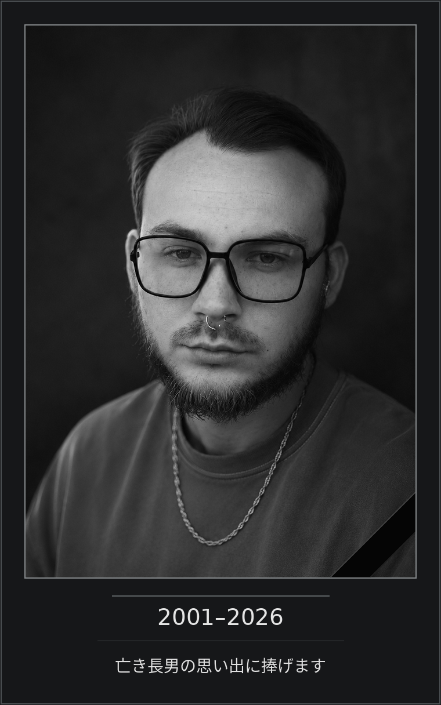
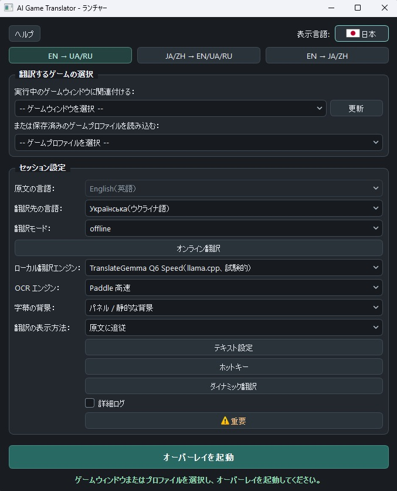

[English](README.md) · [Русский](README.ru.md) · [Українська](README.uk.md) · **日本語** · [简体中文](README.zh-Hans.md) · [繁體中文](README.zh-Hant.md)

<p align="center"></p>

# Games_translator

*アイデアから公開プロジェクトへ*

## きっかけ

Games_translator は、PC ゲーム内のテキストをその場で翻訳するプログラムです。

きっかけは、多くのプレイヤーにとって身近な問題でした。面白いゲームは数え切れないほどあるのに、遊びたい言語に翻訳されているとは限りません。何年もローカライズを待つことも、ファン翻訳しかないことも、ついに翻訳が出ないこともあります。

私は、外部の翻訳ツールに何度も切り替えたり、スクリーンショットを撮ったり、テキストを手でコピーしたりせず、ゲームを起動するだけで内容を理解できるツールが欲しかったのです。

しかし、最初の構想はすぐに広がりました。

字幕だけ、あるいは一つの言語だけに限りたくはありませんでした。画面上の文字を直接認識し、リアルタイムで翻訳し、さまざまな言語の組み合わせに対応しながら、速度、品質、リソース消費のどれを優先するか選べるようにしたかったのです。

完全なオフライン翻訳も大切な条件でした。有料のクラウドサービスを望まない人や利用できない人もいますし、常にインターネットに依存するのが不便なゲームもあります。

こうして Games_translator の開発が始まりました。

## アイデアが実際に使えるプログラムになるまで

当初、このプロジェクトは実際よりもずっと簡単に見えました。

画像の文字を認識することと、認識を十分に速くし、PC に過度の負荷をかけず、さまざまなゲーム内フォントに対応し、ゲームの邪魔をしないようにすることは、まったく別の課題です。

認識したテキストは翻訳し、結果を適切に処理して、間に合うように表示しなければなりません。古い翻訳が次のセリフに重なって出ることも防ぐ必要があります。

開発中は、多くの OCR、翻訳エンジン、ローカル言語モデルとその実行方法を試しました。有望に見えても遅すぎるもの、速くても結果に満足できないもの、RAM や VRAM を使いすぎるものがありました。

個別のテストでは良好でも、実際のゲームでは一見わからない問題が出ることもありました。

比較と検証を重ね、ある案を断念して別の案に戻ることもありました。有望な方法が実用に向かないと、長い試験の末にわかることもありました。

こうして翻訳には三つのアプローチが必要だと考えるようになりました。

**Fast** は、翻訳の品質が常に満足できるものでなくても、速度と低遅延を最優先したいときに使います。

**Quality** は、より意味の通る翻訳を求め、そのためにある程度の処理性能を譲れるときに使います。

**Online** は外部の翻訳サービスを使う方法です。サービスによっては、高い品質と短い待ち時間の両方を得られます。

GPU の活用、メモリ管理、ローカルモデルの起動、バックグラウンド処理、プレイ中の負荷軽減など、ハードウェアに関する課題も大きなものでした。

字幕そのものにも同じくらい注意が必要でした。読みやすく、余計な部分を覆わず、適切に更新され、ゲームごとに見た目を調整できるようにするためです。

その結果、選んだ画面領域の連続翻訳、任意の領域の動的な選択、柔軟な表示設定、ゲーム別プロファイル、ローカル翻訳メモリ、複数の翻訳方向が実現しました。

普段はほとんど意識されない細部の多くにも、個別の調査、修正、繰り返しの試験が必要でした。

Games_translator の開発には長い時間がかかりました。決まった計画に沿って機能を足していくのではなく、解決策と技術的な妥協点を探し続ける過程でした。

もちろん完璧だとは考えていません。各モードには長所と短所があり、ある機能にはかなり高性能な PC が必要です。認識と翻訳の挙動は、どうしてもゲームによって変わります。

それでも、機能を見せるだけのデモではなく、実際に使える完成したアプリケーションにすることができました。

それは私にとって、本当に大切なことでした。

## Games_translator を無料にした理由

当初、Games_translator は商用製品として構想していました。

技術的な興味に加え、開発を最後までやり遂げたい、ごく個人的で大切な理由がありました。

妻はステージ IV のがんと闘っています。高額な治療が必要で、必要な薬の一つは、一箱だけで毎月およそ 1,000 ドルかかります。

私たち家族にとっては非常に大きな金額です。

役に立つプログラムを作り、その売り上げで治療費の一部でもまかなえればと願っていました。大きな商業的成功を期待したのではありません。私たちの状況を少しでも楽にする、もう一つの収入源が欲しかったのです。

だからこそ、単なる試作品にとどめず、Games_translator を少しずつ完成した製品へと育てました。

しかし、今日のソフトウェア開発は非常に速く変化しています。

開発中に、アプリを作るためのツールは身近になり、似たプログラムも、完全に無料のものを含めて次々に登場しました。

商用リリースにさらに何か月もかけるのは、見合わないかもしれないと次第にわかってきました。よくできたプログラムでも、無料の選択肢があれば、十分な購入者が見つかるとは限りません。

もともとの期待は技術的な面だけではなかったので、簡単な決断ではありませんでした。

それでも、商業的な見通しが変わっただけで、これまでの成果を自分の PC に眠らせたくはありませんでした。

そこで最初の配布方針をやめ、Games_translator を希望するすべての人に公開することにしました。

**プログラムは無料で配布し、ソースコードを公開します。**

原作の言語にかかわらず、魅力的な世界や物語、登場人物を知りたいプレイヤーの役に立てばと願っています。

翻訳がなかったため手をつけられなかったゲームを、誰かが最後まで遊ぶ助けになるかもしれません。

そうなれば、Games_translator の開発に費やした時間は決して無駄ではありません。

---

## 献辞

<p align="center"></p>

---

## 作者への任意の支援と家族への援助

Games_translator は完全に無料です。ダウンロード、使用、ソースコードの閲覧に支払いは必要ありません。

### プロジェクトへのお礼

プログラムがお役に立ち、私の仕事に感謝を伝えたいと思われた方は、任意で寄付できます。

### 妻の治療への支援

また、家族を支え、妻の抗がん剤の購入を手助けしていただくこともできます。

一人ひとりに事情やできることがあると理解しています。支援は完全に任意であり、プログラムを利用できるかどうかとは一切関係ありません。

**Games_translator を使ってくださる方、ほかの方に紹介してくださる方、家族を支えてくださる方、皆さまに感謝します。**

支援方法は以下のとおりです。

送金前にアドレスとネットワークを確認してください。寄付は購入ではなく、利用の可否にも影響しません。

**Bitcoin (BTC) · Bitcoin ネットワーク**

```text
bc1quaew6d8gzvspnks5hn93fcnc28xlnvzhy3juc3
```


**Ethereum (ETH) · Ethereum メインネット**

```text
0x76B010657fE338E6f7E8bB251631A42CB15a8924
```


**Tether USDT · TRON/TRC20 のみ**

```text
TN2sQMLi2Q4ziQsFzNe3futuo4SMQmhhgi
```


### 作者への連絡

個人的なご連絡は [gamestranslator.contact@gmail.com](mailto:gamestranslator.contact@gmail.com) までお願いします。不具合や提案は [GitHub Issues](https://github.com/ZGeorg-tech/Games_translator/issues) でも受け付けます。Issues は公開されます。


# Games_translator：機能と技術文書

## 1. Games_translator でできること

Games_translator は、プレイ中にゲーム内テキストを認識して翻訳する、Windows 10/11 用の無料アプリです。

ゲームウィンドウの指定領域をキャプチャし、OCR（光学文字認識）で文字を読み取って翻訳し、ゲームの上に結果を表示します。モードによって、翻訳をすべて PC 上で行うか、外部のオンラインサービスを使います。

**主な機能：**

- ゲーム字幕のリアルタイム翻訳。
- ゲームウィンドウ内の任意の領域を必要に応じて翻訳。
- インターネット接続を必須としない完全ローカル動作。
- Fast、Quality、Online の三つの翻訳方式。
- 所定の翻訳方向で英語、ロシア語、ウクライナ語、日本語、簡体字中国語、繁体字中国語をサポート。
- ゲーム内テキストの種類に応じた複数の OCR エンジン。
- 字幕のフォント、サイズ、色、縁取り、背景を設定。
- 表示領域に合わせてテキストを自動調整。
- 翻訳で元の字幕を覆う機能。
- ゲーム別プロファイルの保存。
- 翻訳を再利用するローカル Translation Memory。
- ホットキーの変更。
- GPU を使うローカルニューラルモデル。
- 外部翻訳 API への接続。
- 六つの表示言語。
- Python と必要なライブラリを同梱したポータブル配布。

ゲームファイルに翻訳をインストールしたり、ゲームのリソースを変更したりはしません。独立したアプリとして、独自のオーバーレイを使用します。

<p align="center"><br><sub>日本語のランチャー画面</sub></p>

---

## 2. 三つの言語ブロック

Games_translator は三つの言語ブロックに分かれています。ブロックごとに対象の翻訳方向とモデルの構成が異なります。

### Block 1：英語 → ロシア語 / ウクライナ語

| 原文 | 翻訳先 |
|---|---|
| English | Русский |
| English | Українська |

英語のゲーム向けです。高速なローカル翻訳に加え、英語 → ロシア語の Marian、TranslateGemma による Quality、オンライン翻訳を使用できます。

### Block 2：日本語 / 中国語 → 英語 / ロシア語 / ウクライナ語

| 原文 | 翻訳先 |
|---|---|
| 日本語 | English、Русский、Українська |
| 简体中文（簡体字中国語） | English、Русский、Українська |
| 繁體中文（繁体字中国語） | English、Русский、Українська |

中国語と日本語向けの OCR を使用します。Fast は Bergamot を使い、ロシア語やウクライナ語に翻訳する場合は英語を経由します。Quality は MiLMMT Q6 を使い、方向に応じて直接翻訳するか、所定の中間言語を経由します。

### Block 3：英語 → 日本語 / 中国語

| 原文 | 翻訳先 |
|---|---|
| English | 日本語 |
| English | 简体中文 |
| English | 繁體中文 |

Fast は日本語に FuguMT、中国語に CSANMT を使用し、繁体字中国語には OpenCC で変換します。Quality は MiLMMT Q6 を使用します。

### ブロックを別々に配布する理由

当初はすべてのモデルとライブラリを含む単一システムで、全体で約 12.49 GiB ありました。

不要な言語モデルをダウンロードせずに済むように、三つの独立した Windows パッケージを用意しました。各パッケージに実行ファイル、ポータブル Python、必要な OCR・翻訳モデル、ライブラリ、ランタイムが含まれます。

**一つのブロックを使うために、残り二つをダウンロードする必要はありません。**

<p align="center"></p>

---

## 3. 翻訳方式の選択

速度、品質、外部サービスの利用から選べることが、主な特徴の一つです。

| 比較項目 | Fast | Quality | Online |
|---|---|---|---|
| 優先する点 | 速度 | 品質 | 選択したサービスの機能 |
| 翻訳時のインターネット | 不要 | 不要 | 必要 |
| PC への負荷 | 通常は低～中程度 | 大きい | 主に OCR と画面表示 |
| 翻訳品質 | 目立つ誤りが出ることがある | 通常、より意味の通る結果 | プロバイダーとモデルによる |
| 待ち時間 | 通常は短い | 長めで、ハードウェアによる | ネットワークと API による |
| 外部サービスへの支払い | 不要 | 不要 | 発生する場合がある |

### Fast：高速翻訳

PC に過度の負荷をかけず、できるだけ早く翻訳が欲しい場面に向けたモードです。速度を重視した比較的軽量な機械翻訳モデルを使います。

文脈、人名、曖昧な表現を誤って解釈することがあります。方向によっては中間言語を経由することも最終品質に影響します。各セリフの正確さよりもゲームを中断せず遊ぶことが重要な場合に適しています。

### Quality：品質重視のローカル翻訳

より重いニューラルモデルを使い、意味をより適切に処理することを目指しますが、リソース消費は多く、通常は遅くなります。Online と異なり、テキストを外部サービスに送信せずローカルで翻訳します。

物語を重視するゲームや会話など、低遅延より意味が大切な場面に適しています。**ローカルの Quality にはより多くの RAM と VRAM が必要で、動作と性能はハードウェアに依存します。**

### Online：外部サービスによる翻訳

外部のクラウド機械翻訳・ニューラル翻訳サービスを利用します。サービスによっては、大きなモデルを自分の GPU で動かすことなく、高品質で低遅延の翻訳が得られます。

- インターネット接続が必要です。
- 登録や API キーが必要なプロバイダーがあります。
- 有料プラン、利用枠、リクエスト頻度の制限がある場合があります。
- 遅延はネットワークとサービスの混雑状況に左右されます。
- 認識されたゲーム内テキストは選んだプロバイダーに送られます。
- 対応していても、自分のアカウントで特定のモデルが使えるとは限りません。

外部 API の費用が発生する場合は、該当するプロバイダーに直接支払います。Games_translator にそれらの有料サブスクリプションは含まれません。

---

## 4. ローカル翻訳エンジン

| モデル / エンジン | 対象 | 用途 |
|---|---|---|
| Bergamot | Block 1、Block 2 | 高速なローカル翻訳 |
| Marian EN→RU | Block 1 | 追加のローカル翻訳エンジン |
| TranslateGemma Q6 | Block 1 | Quality |
| MiLMMT Q6 | Block 2、Block 3 | Quality |
| CSANMT | Block 3 | Fast EN→ZH |
| FuguMT | Block 3 | Fast EN→JA |
| OpenCC | Block 3 | 繁体字中国語への変換 |

**Bergamot** はローカルの Node/WASM ランタイムで、主に CPU を使って高速に翻訳します。**Marian** は英語からロシア語への独立した選択肢です。

**TranslateGemma Q6** は Block 1 の Quality 用です。Low VRAM と Speed は同じモデルを異なる起動パラメーターで実行します。**MiLMMT Q6** は Block 2 と Block 3 がそれぞれの Quality の翻訳方向で共用します。

Block 3 の Fast 用 **CSANMT と FuguMT** は、ゲームと GPU リソースを奪い合わないように CPU での実行を想定しています。モデルはインストール済みのブロックと翻訳プロファイルで決まります。

---

## 5. 文字認識：OCR

翻訳前に、ゲームウィンドウの画像からテキストを検出して認識します。そのために複数の OCR エンジンを用意しています。

| OCR | 主な用途 | 特徴 |
|---|---|---|
| Tesseract | 英語テキスト | 軽量で、明瞭でコントラストの高い文字に適する |
| Paddle Fast | 英語テキスト | 高速なニューラル文字認識 |
| Paddle Full | より難しいゲーム内テキスト | 負荷が大きい認識方式 |
| Paddle CJK Fast | 中国語と日本語 | Block 2 向けの専用 OCR |

選択できる OCR はブロックとテキストの処理モードに応じて変わります。読みやすいフォントと十分なコントラストの英語字幕には **Tesseract**、より多様なゲーム内フォントには主な高速ニューラル方式の **Paddle Fast** を試してください。**Paddle Full** は難しい条件向けですが、負荷や待ち時間が大きくなる場合があります。**Paddle CJK Fast** は日本語と中国語を認識します。

どの OCR も、すべてのゲームで完全に認識できるわけではありません。フォント、文字の大きさ、背景、エフェクト、解像度、キャプチャ領域の選び方が結果に影響します。

---

## 6. Live と Dynamic

二つの主要なテキスト処理方式は、単独でも組み合わせても使えます。

### Live：連続翻訳

字幕や通常の会話など、ほぼ同じ場所に現れるテキストに適しています。ゲームウィンドウの該当箇所に枠を置いて翻訳をオンにします。テキストの変化を検出し、新しい文を認識して翻訳し、表示します。

枠を調整するには Edit を使います。Live に切り替えると、オーバーレイは通常のプレイ用モードになります。認識した文がまだ有効かを確認し、古いリクエストの遅れた結果で新しい翻訳を上書きしないようにします。

### Dynamic：任意の領域を必要に応じて翻訳

Live の枠外の文字を翻訳できます。ホットキーを押し、ゲームウィンドウの目的の領域をマウスで選ぶと、その中身を認識して翻訳します。

特に以下に便利です。

- クエストやジャーナル。
- アイテムの説明。
- インターフェースやメニューの文字。
- 追加の会話。
- 個別のメモやメッセージ。
- 画面上の通常とは異なる場所に現れる文字。

**Dynamic は Live の連続翻訳なしでも単独で使えます。** 多くのゲームでは、**Live で主要な字幕を翻訳し、その他の箇所は必要に応じて Dynamic で翻訳する**組み合わせが便利です。複数の場所にテキストが現れるゲームには、この使い方を勧めます。

---

## 7. 字幕の表示設定

オーバーレイの外観をゲームごとに調整できます。

- フォントサイズと文字色。
- 文字の縁取り。
- 背景プレートの色と透明度。
- 表示領域。
- テキストの自動調整。
- ゲームプロファイルへの表示設定の保存。

### Adaptive Plate：背景色に合わせるプレート

ゲームによっては元の字幕が単色プレート上にあります。Adaptive Plate はその色をゲーム画像から取得し、翻訳の下で元の字幕を覆うために使います。

Live で使用し、対象は **グラデーションのない単色プレートのみ**です。複雑で不均一な背景や変化し続ける背景では、周囲と色が合わない場合があります。オフにすると通常のユーザー設定に戻ります。

### Auto-Fit

Live ではテキストを表示領域に合わせます。Dynamic の Auto-Fit は結果ウィンドウとフォントのサイズを調整します。テキストの長さが変わるたびに設定を手で変える必要を減らします。

---

## 8. ゲームプロファイルと Translation Memory

### プロファイル

ゲームごとに認識、翻訳、表示に必要な設定が異なります。個別のプロファイルに言語、認識領域、翻訳エンジン、OCR、外観、ホットキーなどを保存でき、慣れたゲームを起動するたびに一から設定し直す必要がありません。

### Translation Memory：翻訳メモリ

Translation Memory（TM）は過去の翻訳をローカルで再利用する仕組みです。同じテキストが再び現れ、保存済みの翻訳経路と一致すれば、モデルや外部 API を再度呼び出さずに結果を利用できます。

繰り返されるセリフ、ラベル、メニュー、UI メッセージで特に役立ちます。異なる結果を混同しないよう、翻訳方向と使用した翻訳エンジンの識別情報を考慮します。

TM はローカルに保存されます。一部の外部プロバイダーには統合ポリシーに応じた追加の保存制限があります。**翻訳のクラウド共有やユーザー作成 TM パックの公開は、現バージョンでは未実装です。**

---

## 9. 対応するオンラインプロバイダー

共通の Online Translation システムで、12 系統のプロバイダーに対応しています。

| プロバイダー | 統合方式 |
|---|---|
| DeepL | API による機械翻訳 |
| Google Gemini | API によるニューラル翻訳 |
| Google Cloud Translation | クラウド機械翻訳 |
| Google Translate（非公式） | 公式 API キー不要の外部翻訳 |
| Microsoft Azure Translator | クラウド機械翻訳 |
| OpenAI | ニューラルモデル |
| OpenRouter | API 経由のモデル利用 |
| DeepSeek | ニューラルモデル |
| Qwen-MT | 特化型機械翻訳 |
| Yandex Cloud Translate | クラウド機械翻訳 |
| Baidu Translate | API による機械翻訳 |
| GigaChat | ニューラルモデル |

### 検証状況

すべての統合で経路とレスポンス処理を自動テストしました。ただし、**実アカウントと実際の API キーで試したのは一部のサービスのみ**です。

- **DeepL：** 実際の英語 → ロシア語の試験で 22 件中 22 件が成功。ネットワーク翻訳ワーカーの処理時間の中央値は約 421 ms でした。
- **Gemini：** 実際の翻訳に成功しましたが、検証セッション中に大きな遅延のばらつきとタイムアウトが見られました。
- **OpenRouter：** キーの認証は成功しましたが、選択したモデルへの翻訳リクエストは HTTP 429 を返しました。
- **非公式 Google Translate：** 手動確認で HTTP 302 が返りました。現在の条件下での動作は確認できていません。

これらは特定の試験結果で、現在の外部サービスの性能を保証するものではありません。他の統合の自動テストが成功しても、すべての利用者が特定の API にアクセスできるとは限りません。

### 設定とセキュリティ

プロバイダー、モデル、用意された接続パラメーターを選べます。API キーは Windows DPAPI で保護し、ローカルに保存します。保存済みの認証情報、認証の確認、特定モデルにリクエストできるかどうかは別々の状態です。Live と Dynamic の外部翻訳タイムアウトは個別に設定できます。第三者サービスの可用性、費用、品質は保証しません。

---

## 10. ハードウェアと性能

主に中～高性能のゲーミング PC を想定しています。キャプチャ、OCR、翻訳、表示を並行して行うため、実際の性能は選択した構成とゲームによって変わります。

| コンポーネント | 状況 |
|---|---|
| Windows 10 / Windows 11 | 対象 OS |
| Windows x64 | 配布パッケージのアーキテクチャ |
| NVIDIA GPU | 主な検証環境 |
| CUDA | NVIDIA RTX 3060 で検証 |
| AMD GPU / Vulkan | ソフトウェア上の対応はあるが、AMD 実機での完全な検証は未実施 |
| Intel GPU | 実機での適合性検証は未実施 |
| CPU での Fast 翻訳 | 対応モデルで実装 |
| 適切な GPU がない場合の CPU での Quality | 動作を保証しない |

Fast は通常負荷が小さく、ゲームにリソースを残したいときに適しています。Quality は大きなモデルを使うため、VRAM、RAM、演算リソースを大きく消費する場合があります。Online では翻訳を外部で実行しますが、画像キャプチャ、OCR、UI の負荷はローカルに残ります。

開発時に主に検証した NVIDIA 構成は GeForce RTX 3060 です。別の GPU で同等の速度や互換性が得られる保証はありません。すべてのモードの組み合わせに共通する厳密な最小 RAM・VRAM 要件は未確定です。

---

## 11. Games_translator のダウンロード

Windows x64 向けの三つの独立したポータブルパッケージを用意しています。

| パッケージ | 翻訳方向 | ZIP の容量 | 分割数 |
| --- | --- | ---: | ---: |
| **Block 1** | EN → RU / UK | **5.82 GiB** | 4 |
| **Block 2** | JA / ZH → EN / RU / UK | **6.24 GiB** | 4 |
| **Block 3** | EN → JA / ZH | **8.85 GiB** | 5 |

[Block 1](docs/DOWNLOADS.md#block-1) · [Block 2](docs/DOWNLOADS.md#block-2) · [Block 3](docs/DOWNLOADS.md#block-3) · [GitHub Release R04b](https://github.com/ZGeorg-tech/Games_translator/releases/tag/r04b)

[結合コマンドと SHA256](docs/DOWNLOADS.md)

一つのブロックの分割ファイルをすべて結合すると、一つの ZIP になります。**別のブロックや全体パッケージは不要です。**

### サイズが大きい理由

コードのほかに、大きなローカル言語モデル、OCR モデル、実行用ランタイム、ポータブル Python、必要なライブラリが含まれます。Quality の TranslateGemma Q6 や MiLMMT Q6 は数 GiB あり、Block 3 には CSANMT 用のコンポーネントも入ります。

ローカル翻訳にインターネット接続や外部サービスの契約を必須としない代わりに、配布パッケージのサイズは大きくなります。

---

## 12. インストールと初回起動

システムに別途 Python をインストールする必要はありません。

1. **ダウンロード。** 公開後、Releases で必要なブロックを選び、**そのブロックの分割ファイルをすべて**取得します。例：Block 1 は `Games_translator-Block1-Windows-x64.zip.001` から `Games_translator-Block1-Windows-x64.zip.004` までの四つです。
2. **結合。** 分割ファイルを同じフォルダーに置き、付属の `UNPACK.md` または上記リンクの正確なコマンドで通常の ZIP に結合します。公開される SHA256 と比較できます。
3. **展開。** 書き込み可能なフォルダーに展開します。**パス全体に ASCII 文字のみを使ってください。空白は使えます。** 例：`C:\GamesTranslator\Block1`、`D:\Games\Games Translator`。キリル文字、中国語、日本語などの非 ASCII 文字を含むパスでは、一部の同梱ネイティブライブラリの制約で Paddle OCR や CUDA がリソースを読み込めない場合があります。
4. **起動。** `Games_translator.exe` を実行します。同梱の Python を使うため通常起動にコマンドラインは不要です。初回起動でユーザーデータのフォルダーが作成されます。

### 設定

1. ゲームを起動します。
2. Games_translator を開きます。
3. ゲームウィンドウを選びます。
4. 翻訳方向を選びます。
5. Offline または Online を選びます。
6. Offline では利用できる翻訳エンジン、または Fast/Quality プロファイルを選びます。
7. OCR 設定を確認します。
8. 必要に応じてホットキーと外観を調整します。
9. オーバーレイを起動します。
10. ゲーム内テキストに枠を合わせ、翻訳をオンにします。

**ヘルプ**ボタンを押すと、選択した UI 言語の簡単なガイドが開きます。

---

## 13. ホットキーと操作

ホットキーはプログラムの設定で変更でき、ゲームプロファイルに保存されます。

| 操作 | 用途 |
|---|---|
| 設定 / 翻訳 | 枠の編集と Live を切り替える |
| 翻訳の表示 / 非表示 | テキストの表示を切り替える |
| Dynamic | 任意の領域を選択する |
| Force Refresh | 現在の Live 領域を再認識する |

割り当ては変更できます。キーが効かない場合は、ゲームや別のアプリが横取りしていないか確認してください。

---

## 14. 診断とユーザーデータ

詳細な診断ログは既定でオフです。問題を調べるときは、ランチャーの **詳細ログ** をオンにします。設定は次にオーバーレイを起動したときに反映されます。

ログには技術情報、ゲーム内テキスト、翻訳結果が含まれる場合があります。他の人に渡す前に確認してください。

プロファイル、翻訳メモリ、履歴、設定はユーザーデータであり、変更されないリソースとは分離して保存されます。既定ではアプリ内の `data` フォルダーを使い、システム Python や開発用の隠しディレクトリに作業データを置く必要はありません。

---

## 15. 既知の制約

Games_translator は実用的なアプリですが、あらゆるゲーム、言語の場面、PC に同じように対応できるわけではありません。

- **OCR：** 装飾的なフォント、エフェクト、動く背景、低いコントラストは認識を悪化させる場合があります。
- **Fast：** 速度を重視するため、誤訳、文脈の抜け、不自然な表現が起こり得ます。
- **Quality：** 高性能なハードウェアが必要な場合があり、処理は明らかに遅くなることがあります。
- **Online：** 外部サービス、API へのアクセス、ネットワーク遅延、料金、利用枠に依存します。実際の試験を行ったプロバイダーは一部です。
- **ハードウェア：** 主な検証環境は NVIDIA です。AMD と Intel の全面的な実機検証は行っていません。
- **インストール先：** パスにキリル文字などの非 ASCII 文字は使わないでください。
- **Vulkan：** 基本ランタイムを同梱します。Vulkan パイプラインの永続キャッシュを使う実験版は、公開パッケージに含めません。
- **アンチチート：** ゲームや保護システムによって、キャプチャ、オーバーレイ、グローバルホットキーが制限されることがあります。すべてのゲームとの互換性は保証されません。ゲームの規則に従ってください。
- **元の字幕：** Adaptive Plate は単色プレート向けです。複雑な背景では見た目に違いが出ることがあります。

---

## 16. ソースコードとライセンス

Games_translator のソースコードは公開予定です。使用している第三者のライブラリ、OCR、言語モデル、ランタイムには、それぞれの権利者の条件が適用されます。ライセンス、クレジット、出所は別文書に記載します。モデルの条件とアプリのソースコードのライセンスが異なる場合があります。調査や改変を行う開発者は、再配布する際に各条件を確認してください。

---

## 17. 追加情報

インストールや起動に問題がある場合は、次の点を確認してください。

- 選んだ言語ブロックが正しいこと。
- すべての分割ファイルがあること。
- 展開とチェックサムが正しいこと。
- パスにキリル文字がないこと。
- ゲームウィンドウを利用できること。
- OCR と翻訳方向の選択。
- ローカル翻訳エンジンの準備状況。
- Online の接続設定と制限。

GitHub での公開後、確認できた不具合は Issues で報告できます。Games_translator は無料で提供され、すべてのゲームやハードウェア構成との互換性は保証されません。

**原作の言語にかかわらず、ゲームを楽しんでください。**


[ライセンス、通知、公開状況](licenses/NOTICE.md) · [Issues（公開後）](https://github.com/ZGeorg-tech/Games_translator/issues)
