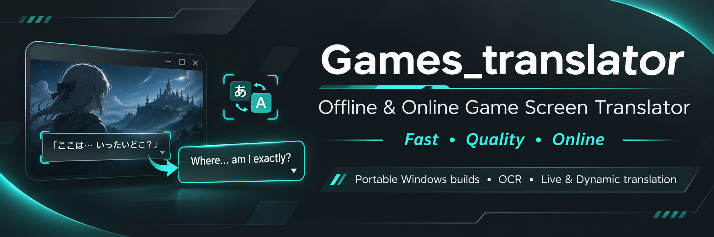
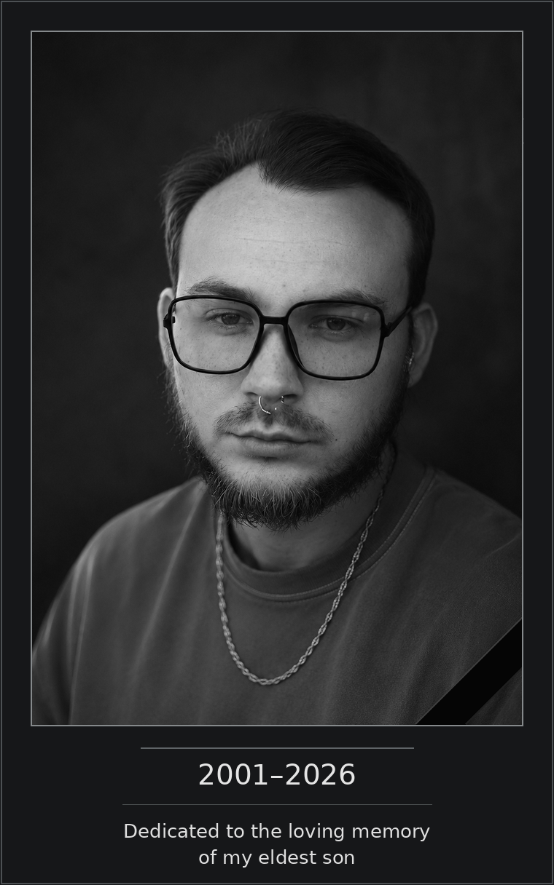
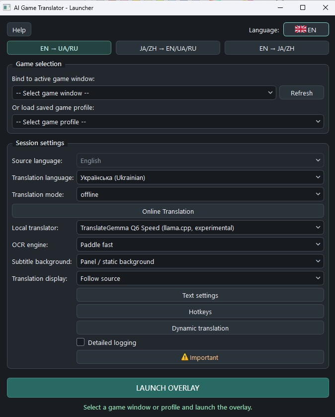
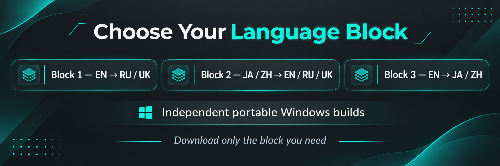

**English** · [Русский](README.ru.md) · [Українська](README.uk.md) · [日本語](README.ja.md) · [简体中文](README.zh-Hans.md) · [繁體中文](README.zh-Hant.md)

<p align="center"></p>

# Games_translator

*From an idea to an open project*

## How it started

Games_translator translates text directly in PC games.

The idea came from a simple problem familiar to many players: there are countless interesting games, but not all of them are translated into the language you need. Sometimes localization takes years; sometimes it is only available as a fan translation; sometimes it never comes at all.

I wanted a tool that would let me launch a game and understand what was happening without constantly switching to another translator, taking screenshots or copying text by hand.

But the original idea soon grew.

I did not want the program to be limited to subtitles or one language. I wanted it to recognize text directly on the screen, translate it in real time, handle several language directions and let users choose between speed, quality and resource use.

Another essential requirement was fully offline translation. Not everyone wants or can afford to use paid cloud services, and for some games being tied to an Internet connection is simply inconvenient.

That was the beginning of Games_translator.

## The long road from an idea to a working application

At first the project looked much simpler than it turned out to be.

Recognizing text in an image is one problem. Making recognition fast enough, keeping the load on the computer reasonable, handling different game fonts and avoiding interference with the game is another matter entirely.

And then the recognized text has to be translated, the result processed correctly and shown on time, without letting an outdated line appear over the next one.

During development I tried many OCR options, translators, local language models and ways to run them. Some looked promising but turned out to be too slow. Others were fast but produced unsatisfactory results. Still others required too much RAM or VRAM.

Some approaches also worked well in isolated tests but revealed problems in real games that were not apparent at first.

I had to compare, test, abandon some options and revisit others. Sometimes it took extensive testing to see that a promising approach was not suitable for practical use.

Gradually I came to the conclusion that translation needed three approaches.

**Fast** is for when speed and low latency matter most, even if the translation is not always satisfactory.

**Quality** is for when a more meaningful translation is needed and the user is willing to trade some performance for it.

**Online** is for when an external translator can be used; depending on the service, it can deliver high quality with low latency.

Hardware was a major challenge in its own right: using the GPU, managing memory, launching local models, organizing background processes and reducing the load while playing.

Subtitles needed just as much attention. The translation should be readable, avoid covering more than necessary, update correctly and let the user tailor the display to a particular game.

The result was continuous translation of a selected region, on-demand selection of arbitrary regions, flexible appearance settings, game profiles, local translation memory and support for several language directions.

Many details that are almost invisible in everyday use required separate investigation, fixes and repeated testing.

Games_translator took a considerable amount of time to develop. It was a continuous search for solutions and technical trade-offs, not a sequence of features added according to a fixed plan.

I do not consider the application perfect. The modes have different advantages and drawbacks, some features need a fairly powerful computer, and recognition and translation inevitably depend on the game.

But I did manage to bring the project to a point where it is a complete, working application people can use, rather than merely a demonstration of what it can do.

And that genuinely mattered to me.

## Why Games_translator became free

Games_translator was originally conceived as a commercial product.

Apart from my interest in the problem itself, I had a very personal and important reason to finish development.

My wife is battling stage IV cancer. She needs expensive treatment, and just one pack of one of the medicines she needs costs about $1,000 each month.

That is a great deal of money for our family.

I hoped I could build something useful and that sales would cover at least part of the treatment costs. I was not expecting a major commercial success. I wanted another source of income that could make our situation a little easier.

That is why I tried not to stop at a simple prototype and gradually turned Games_translator into a finished product.

But software development is changing very quickly today.

While I was working on Games_translator, tools for building applications became more accessible, and similar applications started appearing more often, including completely free ones.

It gradually became clear that spending more months on a commercial launch might not be justified. Even a well-made application may not find enough buyers, especially when free alternatives are available.

It was a difficult decision, because my original hopes for the project were not just technical.

But I did not want the result of all that work to sit on my computer simply because the commercial prospects had changed.

So I decided to abandon the original distribution model and make Games_translator available to anyone who wants it.

**The application is distributed free of charge, with open source code.**

I hope it will be useful to players who want to discover interesting worlds, stories and characters regardless of the original language.

Perhaps it will help someone finish a game they had never gotten around to playing because it lacked a translation.

If so, the time I spent building Games_translator will certainly not have been in vain.

---

## Dedication

<p align="center"></p>

---

## Voluntary support for the author and family

Games_translator is completely free. No payment is required to download or use it, or to study its source code.

### Thank the project author

If the application has been useful to you and you would like to thank me for my work, you can make a voluntary donation.

### Support my wife's treatment

You can also support my family and help us buy cancer medicines for my wife.

I understand that everyone has their own circumstances and means. Any support is entirely voluntary and is not tied to access to the application in any way.

**Thank you to everyone who chooses to use Games_translator, share it with others or support my family.**

The ways to offer support are listed below.

Check the address and network before sending. A donation is not a purchase and does not affect access.

**Bitcoin (BTC) · Bitcoin network**

```text
bc1quaew6d8gzvspnks5hn93fcnc28xlnvzhy3juc3
```


**Ethereum (ETH) · Ethereum mainnet**

```text
0x76B010657fE338E6f7E8bB251631A42CB15a8924
```


**Tether USDT · TRON/TRC20 only**

```text
TN2sQMLi2Q4ziQsFzNe3futuo4SMQmhhgi
```


### Contact the author

For private correspondence, email [gamestranslator.contact@gmail.com](mailto:gamestranslator.contact@gmail.com). Bugs and suggestions may also be submitted through [GitHub Issues](https://github.com/ZGeorg-tech/Games_translator/issues); issues are public.


# Games_translator: features and technical documentation

## 1. What Games_translator does

Games_translator is a free Windows 10/11 application for recognizing and translating game text while you play.

It captures a selected region of a game window, recognizes text in the image using OCR (optical character recognition), translates it and displays the result over the game.

Depending on the mode, translation runs entirely on your computer or uses an external online service.

**Main features:**

- Real-time translation of game subtitles.
- On-demand translation of arbitrary regions in the game window.
- Fully local operation without a mandatory Internet connection.
- Three translation approaches: Fast, Quality and Online.
- English, Russian, Ukrainian, Japanese, Simplified Chinese and Traditional Chinese in the supported directions.
- Several OCR engines for different kinds of game text.
- Configurable subtitles: font, size, color, outline and background.
- Automatic fitting of text to the available area.
- The option to cover original subtitles with the translation.
- Individual game profiles.
- Local Translation Memory for reusing translations.
- Configurable hotkeys.
- Support for local neural models using a GPU.
- External translation APIs.
- Six interface languages.
- Portable distribution with its own Python and required libraries.

The application does not install a translation into game files or modify game assets. It runs separately and uses its own overlay.

<p align="center"><br><sub>Launcher in English</sub></p>

---

## 2. Three language blocks

Games_translator is divided into three language blocks. Each handles particular translation directions and has a corresponding set of models.

### Block 1: English → Russian / Ukrainian

| Source | Target |
|---|---|
| English | Русский |
| English | Українська |

This block is for games with English text. It supports fast local translation, an additional Marian option for English → Russian, Quality translation with TranslateGemma, and online translators.

### Block 2: Japanese / Chinese → English / Russian / Ukrainian

| Source | Available targets |
|---|---|
| 日本語, Japanese | English, Русский, Українська |
| 简体中文, Simplified Chinese | English, Русский, Українська |
| 繁體中文, Traditional Chinese | English, Русский, Українська |

This block uses OCR designed for Chinese and Japanese text. Fast translation uses Bergamot, with an English pivot for Russian or Ukrainian. Quality uses MiLMMT Q6 and translates directly or via the designated pivot, depending on the direction.

### Block 3: English → Japanese / Chinese

| Source | Target |
|---|---|
| English | 日本語 |
| English | 简体中文 |
| English | 繁體中文 |

Fast uses FuguMT for Japanese and CSANMT for Chinese. OpenCC produces Traditional Chinese. Quality uses MiLMMT Q6.

### Why distribute the blocks separately?

Games_translator was originally a single system containing all models and libraries, about 12.49 GiB in total.

Three independent Windows distributions were prepared so users do not have to download language models they do not need. Each includes the executable, portable Python, the required OCR and MT models, libraries and runtimes.

**You do not need the other two blocks to use one.**

<p align="center"></p>

---

## 3. Choosing a translation approach

A key feature is the choice between speed, quality and external services.

| Feature | Fast | Quality | Online |
|---|---|---|---|
| Main priority | Speed | Quality | Capabilities of the selected service |
| Internet for translation | Not required | Not required | Required |
| Load on the computer | Usually low to moderate | Significant | Mainly OCR and the interface |
| Translation quality | Noticeable errors are possible | Usually more meaningful results | Depends on provider and model |
| Latency | Usually low | Higher; hardware-dependent | Depends on network and API |
| External charges | None required | None required | Possible |

### Fast: quick translation

Fast is primarily for gameplay where translation needs to arrive quickly without excessive load. It uses relatively lightweight machine translation models optimized for speed.

It may make mistakes or misread context, names and ambiguous expressions. A pivot translation can also affect the final quality in some directions. Choose Fast when uninterrupted gameplay matters more than the precision of every line.

### Quality: higher-quality local translation

Quality uses heavier neural models for more meaningful text processing, takes more resources and is usually slower. Unlike Online, it runs locally without sending text to a third party.

It is particularly useful for story-heavy games, dialogue and other situations where meaning matters more than low latency. **Local Quality needs more RAM and VRAM; availability and performance depend on the hardware.**

### Online: external translation services

Online uses third-party cloud machine and neural translation services. Depending on the service, it can offer high quality and low latency without running a large model on your own GPU.

- Internet access is required.
- Some providers require registration and an API key.
- Paid plans, quotas and rate limits may apply.
- Latency depends on the network and service load.
- Recognized game text is sent to the selected provider.
- Integration does not guarantee that your account can access a particular model.

Pay the provider directly for its API if required. Games_translator does not include a paid subscription to these services.

---

## 4. Local translators

| Model / engine | Used by | Purpose |
|---|---|---|
| Bergamot | Block 1, Block 2 | Fast local translation |
| Marian EN→RU | Block 1 | Additional local translator |
| TranslateGemma Q6 | Block 1 | Quality |
| MiLMMT Q6 | Block 2, Block 3 | Quality |
| CSANMT | Block 3 | Fast EN→ZH |
| FuguMT | Block 3 | Fast EN→JA |
| OpenCC | Block 3 | Conversion to Traditional Chinese |

**Bergamot** uses a local Node/WASM runtime and is designed for fast, predominantly CPU-based translation. **Marian** is a separate English-to-Russian option.

**TranslateGemma Q6** is the Quality model for Block 1. Low VRAM and Speed use the same model with different launch parameters. **MiLMMT Q6** is shared by Block 2 and Block 3 for their Quality directions.

**CSANMT and FuguMT** Fast routes in Block 3 are CPU-oriented so they do not have to compete with the game for additional GPU resources. The selected model depends on the installed block and translation profile.

---

## 5. Text recognition: OCR

Before translating, Games_translator must find and recognize text in the captured game window image. It offers several OCR engines.

| OCR | Main use | Characteristics |
|---|---|---|
| Tesseract | English text | Lightweight; good for sharp, high-contrast text |
| Paddle Fast | English text | Fast neural recognition |
| Paddle Full | More difficult game text | Heavier recognition option |
| Paddle CJK Fast | Chinese and Japanese | Specialized OCR for Block 2 |

Availability depends on the language block and text mode. Try **Tesseract** for ordinary English subtitles with a clean font and sufficient contrast. **Paddle Fast** is the main fast neural option and handles a wider range of game fonts. **Paddle Full** is intended for harder conditions but may significantly increase load and latency. **Paddle CJK Fast** recognizes Japanese and Chinese text.

No OCR engine guarantees perfect results in every game. Font, character size, background, effects, resolution and the selected capture region all matter.

---

## 6. Live and Dynamic

The two main ways to handle game text can be used separately or together.

### Live: continuous translation

Live is primarily for subtitles, ordinary dialogue and text that appears in roughly the same area. Place the frame over that part of the game window and turn translation on. The program detects changes, recognizes new phrases, translates them and displays the result.

Use Edit to position the frame. Switching to Live puts the overlay into its normal gameplay mode. The program tracks whether a phrase is still current so a delayed result from an older request does not replace a newer translation.

### Dynamic: translate any region on demand

Dynamic translates text outside the main Live frame. Use its hotkey, then select a region of the game window with the mouse. The program recognizes and translates what is inside it.

This is particularly useful for:

- Quests and journals.
- Item descriptions.
- Interface and menu text.
- Additional dialogue.
- Individual notes and messages.
- Text that appears in unusual places.

**Dynamic can run independently**, without continuous Live translation. For many games the most convenient combination is **Live for the main subtitles and Dynamic for everything else on demand**. This is recommended when text appears in different areas.

---

## 7. Subtitle appearance

The overlay can be customized for a particular game:

- Font size and color.
- Text outline.
- Background plate color and opacity.
- Display region.
- Automatic text fitting.
- Appearance saved in the game profile.

### Adaptive Plate

Some games place their original subtitles on a solid colored plate. Adaptive Plate samples that plate from the game image and uses its color to cover the original subtitles beneath the translation.

It is **only for solid plates without gradients** and works in Live. The color may not match complex, uneven or changing backgrounds. Turning it off restores the regular user background settings.

### Auto-Fit

Live fits text to the display region. Dynamic Auto-Fit chooses the result window size and font size. This helps with varying text lengths without constantly changing the settings by hand.

---

## 8. Game profiles and Translation Memory

### Profiles

Games may need different recognition, translation and display settings. Separate game profiles store languages, the recognition region, translator, OCR, appearance, hotkeys and other options. This avoids setting everything up again each time you launch a familiar game.

### Translation Memory

Translation Memory (TM) is a local system for reusing translations. When text recurs and matches a previously stored translation route, the application can reuse the result without calling a model or external API again.

It is particularly useful for repeated dialogue, labels, menus and UI messages. TM accounts for the translation direction and translator identity so incompatible results are not mixed.

TM is stored locally. Some external providers have additional data storage restrictions according to their integration policy. **Cloud sharing of translations and publishing user TM packs are not implemented in this version.**

---

## 9. Supported online providers

Games_translator has a shared Online Translation system with twelve provider families.

| Provider | Integration |
|---|---|
| DeepL | Machine translation API |
| Google Gemini | Neural translation API |
| Google Cloud Translation | Cloud machine translation |
| Google Translate (unofficial) | External translation without an official API key |
| Microsoft Azure Translator | Cloud machine translation |
| OpenAI | Neural models |
| OpenRouter | Access to models via API |
| DeepSeek | Neural models |
| Qwen-MT | Specialized machine translation |
| Yandex Cloud Translate | Cloud machine translation |
| Baidu Translate | Machine translation API |
| GigaChat | Neural models |

### Validation status

All integrations underwent automated routing and response handling tests. **Not all services were tested with real accounts and API keys.**

- **DeepL:** a real English → Russian test completed 22 of 22 requests successfully. The network translation worker's median time was about 421 ms in that test.
- **Gemini:** real translations succeeded, but the tested session showed substantial latency variation and timeouts.
- **OpenRouter:** key authorization succeeded, but a translation request to the selected model returned HTTP 429.
- **Unofficial Google Translate:** a manual check returned HTTP 302. Operation under current conditions was not confirmed.

These findings are specific to those tests and do not guarantee current external service performance. Automated results for the other integrations are not confirmation that a particular API will be available to every user.

### Settings and security

Online settings let you choose the provider, model and available connection parameters. API keys are stored locally using Windows DPAPI. Stored credentials, confirmed authorization and the ability to make a request to a particular model are distinct. Live and Dynamic have independent external translation timeouts. The application does not guarantee third-party service availability, cost or quality.

---

## 10. Hardware and performance

Games_translator is primarily intended for mid-range and high-end gaming computers. It captures images, performs OCR, translates and displays the result at the same time, so performance depends on the components chosen and the game itself.

| Component | Status |
|---|---|
| Windows 10 / Windows 11 | Target operating systems |
| Windows x64 | Architecture of the prepared bundles |
| NVIDIA GPU | Main tested platform |
| CUDA | Tested on NVIDIA RTX 3060 |
| AMD GPU / Vulkan | Software support exists; full AMD testing has not been done |
| Intel GPU | Not hardware-qualified |
| Fast translation on CPU | Implemented for the applicable models |
| Quality on CPU without a suitable GPU | Not a guaranteed mode |

Fast usually has lower load and is better when the game needs to retain resources. Quality uses larger models and may consume significant VRAM, RAM and compute. Online moves translation to an external server but image capture, OCR and the interface remain local.

The main NVIDIA configuration tested during development was a GeForce RTX 3060. Another GPU does not guarantee identical speed or compatibility. Universal minimum RAM and VRAM requirements for every combination of modes have not been established.

---

## 11. Downloading Games_translator

The application is distributed in three independent portable Windows x64 bundles.

| Package | Directions | ZIP size | Parts |
| --- | --- | ---: | ---: |
| **Block 1** | EN → RU / UK | **5.82 GiB** | 4 |
| **Block 2** | JA / ZH → EN / RU / UK | **6.24 GiB** | 4 |
| **Block 3** | EN → JA / ZH | **8.85 GiB** | 5 |

[Block 1](docs/DOWNLOADS.md#block-1) · [Block 2](docs/DOWNLOADS.md#block-2) · [Block 3](docs/DOWNLOADS.md#block-3) · [GitHub Release R04b](https://github.com/ZGeorg-tech/Games_translator/releases/tag/r04b)

[Exact reassembly commands and SHA256](docs/DOWNLOADS.md)

All archive parts for one block form a single ZIP. **You do not need to download the other blocks or the full build.**

### Why is the download so large?

Besides application code, the bundles include large local language models, OCR models, runtimes, portable Python and the required libraries. Quality uses multi-gigabyte TranslateGemma Q6 or MiLMMT Q6 models, and Block 3 also includes CSANMT dependencies.

This lets local translation run without mandatory Internet access or an external subscription. The trade-off for autonomy is a larger distribution.

---

## 12. Installation and first launch

No separate system Python installation is required.

1. **Download.** When Releases become available, pick a block and download **all parts of that block only**. Block 1, for example, has `Games_translator-Block1-Windows-x64.zip.001` through `Games_translator-Block1-Windows-x64.zip.004`.
2. **Join the archive.** Put the parts in the same folder, then use the supplied `UNPACK.md` or the exact commands and SHA256 manifest linked above to create the ordinary ZIP and verify its checksum.
3. **Extract.** Choose a writable folder. **The entire path must use ASCII characters; spaces are allowed.** Examples: `C:\GamesTranslator\Block1` and `D:\Games\Games Translator`. Avoid Cyrillic, Chinese, Japanese and other non-ASCII characters: some bundled native libraries may prevent Paddle OCR or CUDA from loading resources on such paths.
4. **Launch.** Open `Games_translator.exe`. It uses its own Python environment and needs no console for normal startup. A user data directory is created on the first launch.

### Setup

1. Launch the game.
2. Open Games_translator.
3. Select the game window.
4. Select the language direction.
5. Choose Offline or Online.
6. In Offline, choose an available translator or Fast/Quality profile.
7. Check the OCR settings.
8. Adjust hotkeys and appearance if needed.
9. Start the overlay.
10. Place the frame over the game text and start translation.

The built-in **Help** button opens a short guide in the selected interface language.

---

## 13. Hotkeys and controls

Hotkeys are configured in the application and saved in the game profile.

| Action | Purpose |
|---|---|
| Setup / translation | Switch between frame editing and Live |
| Show / hide translation | Toggle translation visibility |
| Dynamic | Select an arbitrary region |
| Force Refresh | Recognize the current Live region again |

You can change the assignments. If a shortcut does not work, check whether the game or another application intercepts it.

---

## 14. Diagnostics and user data

Detailed diagnostic logging is off by default. Enable **Detailed logging** in the launcher to investigate a problem. The change takes effect the next time the overlay starts.

Logs may contain technical details, game text and translations. Review them before sharing.

Profiles, TM, history and settings are user data stored separately from immutable resources. By default Games_translator uses its own local `data` folder and does not require keeping working data in the system Python installation or hidden development directories.

---

## 15. Known limitations

Games_translator is a working application, but it cannot handle every game, linguistic situation or computer equally well.

- **OCR:** artistic fonts, effects, moving backgrounds and low contrast can degrade recognition.
- **Fast:** high speed can come at the expense of accuracy, context and natural phrasing.
- **Quality:** may require powerful hardware and run substantially slower.
- **Online:** depends on third-party services, API access, network delays, prices and quotas. Not all providers have undergone real tests.
- **Hardware:** NVIDIA is the main tested platform; AMD and Intel are not fully hardware-qualified.
- **Installation path:** avoid Cyrillic and other non-ASCII characters.
- **Vulkan:** prepared bundles contain the baseline runtime. The experimental persistent Vulkan pipeline cache variant is not included in the public distribution.
- **Anti-cheat:** games and protection systems may restrict capture, overlays and global hotkeys. Universal compatibility is not guaranteed; follow each game's rules.
- **Original subtitles:** Adaptive Plate is designed for solid backgrounds. Complex backgrounds may show visible differences.

---

## 16. Source code and licenses

The project is intended to publish the Games_translator source openly. It uses third-party libraries, OCR systems, language models and runtimes governed by their respective rights holders. Licensing, attribution and provenance are documented separately. Model terms may differ from the application source license. Developers who study or modify the program must take those terms into account before redistributing it.

---

## 17. More information

If installation or startup is difficult, check:

- The selected language block.
- That you have all archive parts.
- Extraction and checksum integrity.
- That the path contains no Cyrillic characters.
- That the game window is available.
- The chosen OCR and translation direction.
- Whether the local translator is ready.
- Online connection settings and limits.

Once the GitHub repository is public, use Issues for confirmed bugs. Games_translator is provided free of charge without guaranteeing compatibility with every game or hardware configuration.

**Enjoy your game, whatever its original language.**


[Licenses, notices and publication status](licenses/NOTICE.md) · [Issues (after publication)](https://github.com/ZGeorg-tech/Games_translator/issues)
