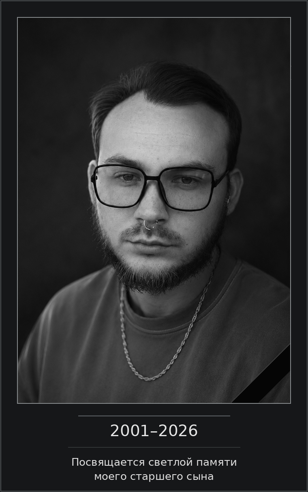
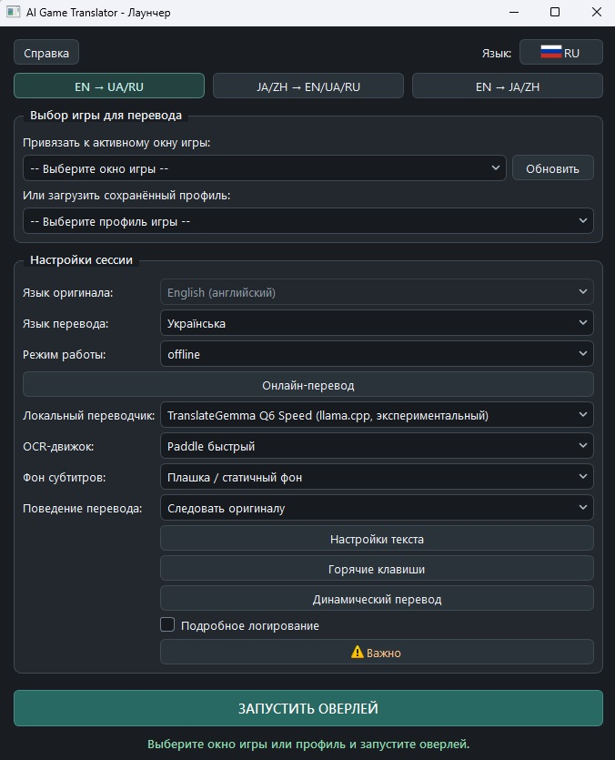

[English](README.md) · **Русский** · [Українська](README.uk.md) · [日本語](README.ja.md) · [简体中文](README.zh-Hans.md) · [繁體中文](README.zh-Hant.md)

<p align="center"></p>

# Games_translator

*От идеи до открытого проекта*

## Как всё начиналось

Games_translator — это программа для перевода текста непосредственно в компьютерных играх.

Идея её создания возникла из довольно простой и знакомой многим игрокам проблемы: существует огромное количество интересных игр, но далеко не каждая из них имеет перевод на нужный язык. Иногда локализацию приходится ждать годами, иногда она существует только в любительском исполнении, а иногда её не будет вовсе.

Мне хотелось получить инструмент, который позволил бы просто запустить игру и понимать происходящее, не отвлекаясь постоянно на сторонние переводчики, скриншоты или ручное копирование текста.

Но довольно быстро первоначальная задумка стала шире.

Я хотел, чтобы программа не ограничивалась только субтитрами или одним языком. Чтобы она могла распознавать текст непосредственно на экране, переводить его в реальном времени, работать с разными языковыми направлениями и при этом давать пользователю выбор между скоростью, качеством и потреблением ресурсов.

Ещё одним принципиальным условием была возможность полноценного автономного перевода. Не у каждого есть желание или возможность пользоваться платными облачными сервисами, а для некоторых игр постоянная зависимость от интернета просто неудобна.

Так началась разработка Games_translator.

## Долгий путь от идеи к работающей программе

Первоначально проект казался значительно проще, чем оказался на практике.

Распознать текст на изображении — одна задача. Сделать так, чтобы это распознавание работало достаточно быстро, не перегружало компьютер, справлялось с различными игровыми шрифтами и не мешало самой игре, — уже совсем другая.

А ведь распознанный текст нужно ещё перевести, правильно обработать результат, вовремя показать его на экране и не допустить, чтобы устаревшая фраза появилась поверх следующей.

За время разработки мне пришлось попробовать множество вариантов OCR, различных переводчиков, локальных языковых моделей и способов их запуска. Некоторые решения выглядели многообещающе, но оказывались слишком медленными. Другие работали быстро, но давали неудовлетворительный результат. Третьи требовали слишком много оперативной или видеопамяти.

Были и решения, которые хорошо показывали себя в отдельных тестах, но в реальных играх обнаруживали проблемы, неочевидные на первый взгляд.

Приходилось сравнивать, проверять, отказываться от одних вариантов и возвращаться к другим. Иногда после продолжительных испытаний становилось ясно, что перспективное направление не подходит для практического использования.

Постепенно я пришёл к необходимости разделить перевод на три подхода.

**Fast** — когда важнее всего скорость и минимальная задержка, даже если качество перевода не всегда удовлетворительное.

**Quality** — когда требуется более осмысленный перевод и пользователь готов пожертвовать частью производительности.

**Online** — когда можно воспользоваться внешним переводчиком, который в зависимости от сервиса способен обеспечить высокое качество при небольшой задержке.

Отдельной большой задачей стала работа с оборудованием: использование видеокарты, управление памятью, запуск локальных моделей, организация фоновых процессов и снижение нагрузки во время игры.

Не меньше внимания потребовали сами субтитры. Перевод должен быть читаемым, не перекрывать лишнего, правильно обновляться и позволять пользователю настроить отображение под конкретную игру.

В результате появились постоянный перевод выбранной области экрана, динамическое выделение произвольных участков, гибкие настройки оформления, игровые профили, локальная память переводов и поддержка нескольких языковых направлений.

Множество небольших деталей, которые практически незаметны при обычном использовании, потребовали отдельных исследований, исправлений и повторных испытаний.

Разработка Games_translator заняла немало времени. Это был постоянный процесс поиска решений и технических компромиссов, а не последовательное добавление функций по заранее готовому плану.

Конечно, я не считаю программу идеальной. У разных режимов есть свои преимущества и недостатки, некоторые возможности требуют достаточно мощного компьютера, а поведение распознавания и перевода неизбежно зависит от конкретной игры.

Но в итоге мне удалось довести проект до состояния полноценного рабочего приложения, которым можно пользоваться, а не просто демонстрировать его возможности.

И для меня это было действительно важно.

## Почему Games_translator стал бесплатным

Изначально Games_translator задумывался как коммерческий продукт.

Помимо интереса к самой задаче, у меня была очень личная и важная причина довести разработку до конца.

Моя жена борется с онкологическим заболеванием IV стадии. Ей необходимо дорогостоящее лечение, и только одна упаковка одного из необходимых препаратов обходится примерно в 1 000 долларов ежемесячно.

Для нашей семьи это огромные деньги.

Я надеялся, что смогу создать полезную программу, продажи которой хотя бы частично помогут оплачивать лечение. Это не было ожиданием большого коммерческого успеха. Мне хотелось получить дополнительный источник средств, который позволил бы немного облегчить нашу ситуацию.

Именно поэтому я старался не ограничиваться простым прототипом, а постепенно доводил Games_translator до состояния законченного продукта.

Однако разработка программного обеспечения сегодня меняется чрезвычайно быстро.

Пока я работал над Games_translator, инструменты создания приложений становились всё доступнее, а похожие программы начали появляться всё чаще, в том числе совершенно бесплатные.

Постепенно стало понятно, что дальнейшие месяцы работы над коммерческим выпуском могут оказаться неоправданными. Даже хорошо сделанная программа не обязательно найдёт достаточное количество покупателей, особенно когда у людей появляются бесплатные альтернативы.

Это было непростое решение, поскольку первоначальные надежды на проект были связаны не только с его технической стороной.

Но мне не хотелось, чтобы результат всей проделанной работы остался лежать на моём компьютере только потому, что коммерческие перспективы изменились.

Поэтому я решил отказаться от первоначальной модели распространения и открыть Games_translator для всех желающих.

**Программа распространяется бесплатно, с открытым исходным кодом.**

Надеюсь, она окажется полезной игрокам, которым хочется знакомиться с интересными мирами, историями и персонажами независимо от языка оригинала.

Возможно, кому-то она поможет пройти игру, до которой раньше просто не доходили руки из-за отсутствия перевода.

И тогда время, потраченное на создание Games_translator, точно не окажется напрасным.

---

## Посвящение

<p align="center"></p>

---

## Добровольная поддержка автора и помощь семье

Games_translator полностью бесплатен. Для скачивания, использования и изучения исходного кода не требуется никакой оплаты.

### Благодарность за проект

Если программа оказалась вам полезна и вы захотите отблагодарить меня за проделанную работу, вы можете сделать добровольное пожертвование.

### Помощь с лечением жены

Также вы можете поддержать мою семью и помочь с приобретением противоопухолевых препаратов для моей жены.

Я понимаю, что у каждого свои обстоятельства и возможности. Поэтому любая поддержка остаётся исключительно добровольной и никак не связана с доступом к программе.

**Спасибо всем, кто решил воспользоваться Games_translator, поделиться им с другими или поддержать мою семью.**

Способы поддержки представлены ниже.


Перед переводом проверьте адрес и сеть. Пожертвование не является покупкой и не влияет на доступ к программе.

**Bitcoin (BTC) · сеть Bitcoin**

```text
bc1quaew6d8gzvspnks5hn93fcnc28xlnvzhy3juc3
```


**Ethereum (ETH) · основная сеть Ethereum**

```text
0x76B010657fE338E6f7E8bB251631A42CB15a8924
```


**Tether USDT · только TRON/TRC20**

```text
TN2sQMLi2Q4ziQsFzNe3futuo4SMQmhhgi
```


### Связь с автором

По личным вопросам можно написать: [gamestranslator.contact@gmail.com](mailto:gamestranslator.contact@gmail.com). Сообщения об ошибках и предложения также можно оставлять в [GitHub Issues](https://github.com/ZGeorg-tech/Games_translator/issues); они публичны.


---

# Games_translator — возможности и техническая документация

## 1. Что умеет Games_translator

Games_translator — бесплатное приложение для Windows 10/11, предназначенное для распознавания и перевода игрового текста непосредственно во время игры.

Программа захватывает изображение выбранной области игрового окна, распознаёт находящийся в ней текст с помощью OCR (оптического распознавания символов), переводит его и отображает результат поверх игры.

В зависимости от выбранного режима перевод может выполняться полностью на компьютере пользователя или через внешний онлайн-сервис.

**Основные возможности:**

- Перевод игровых субтитров в режиме реального времени.
- Перевод произвольных участков игрового окна по запросу.
- Полностью локальная работа без обязательного подключения к интернету.
- Три подхода к переводу: Fast, Quality и Online.
- Поддержка английского, русского, украинского, японского, упрощённого и традиционного китайского языков в предусмотренных направлениях.
- Несколько OCR-движков для различных типов игрового текста.
- Настраиваемые субтитры: шрифт, размер, цвет, обводка и фон.
- Автоматическая подгонка текста под доступную область.
- Возможность перекрывать оригинальные субтитры переводом.
- Сохранение индивидуальных игровых профилей.
- Локальная Translation Memory для повторного использования переводов.
- Настраиваемые горячие клавиши.
- Поддержка локальных нейросетевых моделей с использованием GPU.
- Подключение внешних переводческих API.
- Шесть языков интерфейса.
- Портативная поставка с собственным Python и необходимыми библиотеками.

Программа не устанавливает перевод непосредственно в файлы игры и не изменяет игровые ресурсы. Она работает как отдельное приложение с собственным оверлеем.

<p align="center"><br><sub>Главное окно лаунчера на русском</sub></p>

---

## 2. Три языковых блока

Games_translator разделён на три языковых блока. Каждый из них предназначен для определённых направлений перевода и использует соответствующий набор моделей.

### Block 1 — английский → русский / украинский

| Исходный язык | Язык перевода |
|---|---|
| English | Русский |
| English | Українська |

Этот блок предназначен для игр с английским текстом.

Он поддерживает быстрый локальный перевод, дополнительный вариант Marian для английского → русского, качественный перевод через TranslateGemma и онлайн-переводчики.

### Block 2 — японский / китайский → английский / русский / украинский

| Исходный язык | Доступные языки перевода |
|---|---|
| 日本語 — японский | English, Русский, Українська |
| 简体中文 — упрощённый китайский | English, Русский, Українська |
| 繁體中文 — традиционный китайский | English, Русский, Українська |

Этот блок использует OCR, предназначенный для распознавания китайского и японского текста.

Быстрый перевод выполняется с использованием Bergamot. При переводе на русский или украинский применяется промежуточный английский маршрут.

Качественный перевод использует MiLMMT Q6. В зависимости от направления перевод выполняется непосредственно либо через предусмотренный промежуточный маршрут.

### Block 3 — английский → японский / китайский

| Исходный язык | Язык перевода |
|---|---|
| English | 日本語 |
| English | 简体中文 |
| English | 繁體中文 |

В быстром режиме используются FuguMT для японского и CSANMT для китайского. Традиционный китайский получается с помощью OpenCC.

В качественном режиме используется MiLMMT Q6.

### Почему блоки распространяются отдельно?

Изначально Games_translator представлял собой единую систему со всеми моделями и библиотеками. Полный комплект занимал примерно 12,49 ГиБ.

Чтобы пользователям не приходилось скачивать ненужные языковые модели, подготовлены три самостоятельных Windows-дистрибутива.

Каждый содержит исполняемый файл, портативный Python, необходимые OCR- и MT-модели, библиотеки и runtime.

**Для работы одного блока не нужно скачивать два остальных.**

---

<p align="center"></p>

## 3. Выбор способа перевода

Одна из ключевых особенностей Games_translator — возможность выбирать между скоростью, качеством и использованием внешних сервисов.

### Сравнение режимов

| Характеристика | Fast | Quality | Online |
|---|---|---|---|
| Основной приоритет | Скорость | Качество | Возможности выбранного сервиса |
| Интернет для перевода | Не требуется | Не требуется | Требуется |
| Нагрузка на компьютер | Обычно невысокая или умеренная | Значительная | Преимущественно OCR и интерфейс |
| Качество перевода | Возможны заметные ошибки | Обычно более осмысленный результат | Зависит от провайдера и модели |
| Задержка | Обычно небольшая | Выше, зависит от оборудования | Зависит от сети и API |
| Внешняя оплата | Не требуется | Не требуется | Возможна |

### Fast — быстрый перевод

Fast предназначен прежде всего для игрового процесса, где важно получить перевод как можно быстрее и не создавать чрезмерную нагрузку на компьютер.

Используются сравнительно лёгкие модели машинного перевода, ориентированные на скорость.

Однако следует учитывать, что Fast может допускать ошибки, неправильно интерпретировать контекст, имена и неоднозначные выражения. В некоторых языковых направлениях промежуточный перевод также может влиять на итоговое качество.

Этот режим рекомендуется, когда важнее непрерывность игрового процесса, чем точность каждой реплики.

### Quality — качественный локальный перевод

Quality использует более тяжёлые нейросетевые модели.

Он рассчитан на более осмысленную обработку текста, однако требует больше ресурсов и обычно работает медленнее.

В отличие от Online, перевод выполняется локально и не требует отправки текста внешнему сервису.

Quality особенно интересен для сюжетных игр, диалогов и других ситуаций, где смысл текста важнее минимальной задержки.

**Важно:** локальный Quality предъявляет повышенные требования к оперативной и видеопамяти. Его работоспособность и производительность зависят от конкретного оборудования.

### Online — перевод через внешние сервисы

Online позволяет использовать сторонние облачные системы машинного и нейросетевого перевода.

В зависимости от выбранного сервиса можно получить одновременно высокое качество и небольшую задержку без необходимости запускать большую языковую модель на собственном GPU.

Но у Online есть особенности:

- требуется подключение к интернету;
- некоторые провайдеры требуют регистрацию и API-ключ;
- возможны платные тарифы, квоты и ограничения частоты запросов;
- задержка зависит от сети и загруженности сервиса;
- распознанный игровой текст передаётся выбранному провайдеру;
- наличие интеграции не гарантирует, что конкретная модель доступна вашему аккаунту.

Оплата внешнего API, если она требуется, осуществляется непосредственно соответствующему провайдеру. Games_translator не включает платную подписку на эти сервисы.

---

## 4. Локальные переводчики

### Используемые модели

| Модель / движок | Применение | Назначение |
|---|---|---|
| Bergamot | Block 1, Block 2 | Быстрый локальный перевод |
| Marian EN→RU | Block 1 | Дополнительный локальный переводчик |
| TranslateGemma Q6 | Block 1 | Quality |
| MiLMMT Q6 | Block 2, Block 3 | Quality |
| CSANMT | Block 3 | Fast EN→ZH |
| FuguMT | Block 3 | Fast EN→JA |
| OpenCC | Block 3 | Преобразование китайского текста в традиционное письмо |

### Особенности работы

**Bergamot** использует локальный Node/WASM runtime и рассчитан на быстрый перевод с преимущественной нагрузкой на CPU.

**Marian** применяется как отдельный вариант перевода английского текста на русский.

**TranslateGemma Q6** используется для качественного перевода в Block 1. Предусмотрены профили Low VRAM и Speed, использующие одну модель с различными параметрами запуска.

**MiLMMT Q6** используется в Block 2 и Block 3. Это общая языковая модель, поддерживающая соответствующие направления Quality.

**CSANMT и FuguMT** в быстрых маршрутах Block 3 ориентированы на выполнение через CPU, чтобы не создавать дополнительную конкуренцию игре за ресурсы видеокарты.

Выбор модели зависит от установленного блока и выбранного профиля перевода.

---

## 5. Распознавание текста — OCR

Прежде чем переводить текст, Games_translator должен обнаружить и распознать его на изображении игрового окна.

Для этого используются несколько OCR-движков.

| OCR | Основное назначение | Особенности |
|---|---|---|
| Tesseract | Английский текст | Лёгкий, хорошо подходит для чёткого контрастного текста |
| Paddle Fast | Английский текст | Быстрое нейросетевое распознавание |
| Paddle Full | Более сложный игровой текст | Более тяжёлый вариант распознавания |
| Paddle CJK Fast | Китайский и японский текст | Специализированный OCR для Block 2 |

Доступность OCR зависит от языкового блока и выбранного режима работы с текстом.

### Как выбрать OCR?

**Tesseract** стоит попробовать для обычных английских субтитров с чётким шрифтом и достаточно контрастным фоном.

**Paddle Fast** подходит для более разнообразных игровых шрифтов и является основным быстрым нейросетевым вариантом.

**Paddle Full** предназначен для более сложных условий распознавания, но может создавать значительно большую нагрузку и задержку.

**Paddle CJK Fast** используется при распознавании японского и китайского текста.

Ни один OCR не способен гарантировать идеальное распознавание во всех играх.

Результат зависит от шрифта, размера символов, фона, графических эффектов, разрешения и правильности выбора области захвата.

---

## 6. Режимы Live и Dynamic

Games_translator поддерживает два основных способа работы с игровым текстом.

Их можно использовать по отдельности или вместе.

### Live — постоянный перевод

Live предназначен прежде всего для субтитров, обычных диалогов и текста, который появляется приблизительно в одной области экрана.

Пользователь размещает рамку поверх соответствующего участка игрового окна и включает перевод.

Программа отслеживает изменения текста, распознаёт новые фразы, переводит их и отображает результат.

Для настройки рамки используется режим Edit. После переключения в Live оверлей работает в обычном игровом режиме.

При обновлении текста программа учитывает актуальность распознанной фразы, чтобы задержавшийся результат предыдущего запроса не подменял более новый перевод.


### Dynamic — перевод произвольной области

Dynamic позволяет переводить текст вне основной рамки Live.

По горячей клавише пользователь выделяет мышью нужный участок игрового окна, после чего программа распознаёт и переводит его содержимое.

Это особенно удобно для:

- игровых заданий и журналов;
- описаний предметов;
- текстов интерфейса и меню;
- дополнительных диалогов;
- отдельных записок и сообщений;
- текста, появляющегося в нестандартных местах экрана.

**Dynamic можно использовать полностью самостоятельно**, без постоянного Live-перевода.

Однако для многих игр наиболее удобен совместный режим:

**Live переводит основные субтитры, а Dynamic позволяет по необходимости переводить всё остальное.**

Именно такую комбинацию рекомендуется использовать в играх, где текст появляется в нескольких разных областях.


---

## 7. Настройка субтитров

Оверлей Games_translator позволяет изменять оформление перевода в соответствии с особенностями конкретной игры.

Доступны:

- размер и цвет шрифта;
- обводка текста;
- цвет и прозрачность фоновой подложки;
- настройка области отображения;
- автоматическая подгонка текста;
- сохранение оформления в игровом профиле.

### Adaptive Plate — адаптивная подложка

В некоторых играх оригинальные субтитры размещены поверх однотонной цветной плашки.

Adaptive Plate позволяет подобрать цвет такой подложки по изображению игры и использовать его для перекрытия оригинальных субтитров под переводом.

Режим предназначен **только для однотонных подложек без градиентов** и используется в Live.

На сложных, неоднородных или постоянно изменяющихся фонах цвет может не совпадать с окружающим изображением.

При отключении Adaptive Plate восстанавливаются обычные пользовательские настройки фоновой плашки.

### Auto-Fit

Для Live предусмотрена подгонка текста под область отображения.

В Dynamic Auto-Fit используется для подбора размера окна результата и шрифта.

Это помогает работать с текстами разной длины без постоянного ручного изменения настроек.


---

## 8. Игровые профили и Translation Memory

### Профили

Для разных игр могут требоваться разные параметры распознавания, перевода и отображения.

Games_translator позволяет сохранять отдельные игровые профили.

В них хранятся соответствующие настройки: языки, область распознавания, переводчик, OCR, оформление, горячие клавиши и другие параметры.

Это избавляет от необходимости полностью настраивать программу перед каждым запуском знакомой игры.

### Translation Memory — память переводов

Translation Memory (TM) — локальная система повторного использования уже полученных переводов.

Если текст встречается повторно и соответствует ранее сохранённому маршруту перевода, программа может использовать имеющийся результат без повторного обращения к модели или внешнему API.

Это особенно полезно для игр с повторяющимися репликами, надписями, меню и интерфейсными сообщениями.

TM учитывает параметры направления перевода и идентичность используемого переводчика, чтобы не смешивать несовместимые результаты.

Память переводов хранится локально.

Для отдельных внешних провайдеров действуют дополнительные ограничения на сохранение данных в соответствии с политикой соответствующей интеграции.

**Облачный обмен готовыми переводами и публикация пользовательских пакетов TM в текущей версии не реализованы.**

---

## 9. Поддерживаемые онлайн-провайдеры

В Games_translator реализована общая система Online Translation с двенадцатью семействами провайдеров.

| Провайдер | Тип интеграции |
|---|---|
| DeepL | Машинный перевод через API |
| Google Gemini | Нейросетевой перевод через API |
| Google Cloud Translation | Облачный машинный перевод |
| Google Translate (неофициальный) | Внешний перевод без официального API-ключа |
| Microsoft Azure Translator | Облачный машинный перевод |
| OpenAI | Нейросетевые модели |
| OpenRouter | Доступ к моделям через API |
| DeepSeek | Нейросетевые модели |
| Qwen-MT | Специализированный машинный перевод |
| Yandex Cloud Translate | Облачный машинный перевод |
| Baidu Translate | Машинный перевод через API |
| GigaChat | Нейросетевые модели |

### Степень проверки

Все интеграции проходили автоматические проверки соответствующих маршрутов и механизмов обработки ответов.

Однако **не все сервисы проверялись с реальными учётными записями и API-ключами**.

Подтверждённые игровые испытания включают:

**DeepL:** реальный тест английского → русского, 22 успешных запроса из 22. Медиана времени сетевого переводческого worker в этом испытании составила приблизительно 421 мс.

**Gemini:** реальные переводы выполнялись успешно, но в проверенном сеансе наблюдались заметные колебания задержки и таймауты.

**OpenRouter:** проверка авторизации ключа выполнялась успешно, однако запрос перевода к выбранной модели возвращал HTTP 429.

**Неофициальный Google Translate:** при ручной проверке наблюдался HTTP 302. Работоспособность этой интеграции в текущих условиях не подтверждена.

Эти результаты относятся к конкретным испытаниям и не являются гарантией текущей производительности внешних сервисов.

Для остальных интеграций успешные автоматические проверки не следует понимать как подтверждение доступности конкретного API для каждого пользователя.

### Настройки и безопасность

Настройки Online позволяют выбрать провайдера, соответствующую модель и предусмотренные параметры подключения.

API-ключи сохраняются локально с использованием механизмов защиты Windows DPAPI.

Различаются сохранённые учётные данные, подтверждённая авторизация и фактическая возможность выполнить запрос к конкретной модели.

Для Live и Dynamic предусмотрены независимые настройки таймаутов внешнего перевода.

Программа не гарантирует доступность, стоимость или качество услуг третьих сторон.


---

## 10. Оборудование и производительность

Games_translator рассчитан прежде всего на игровые компьютеры среднего и высокого уровня.

Поскольку программа одновременно выполняет захват изображения, OCR, перевод и отображение результата, её фактическая производительность зависит от выбранных компонентов и самой игры.

### Поддержка оборудования

| Компонент | Состояние |
|---|---|
| Windows 10 / Windows 11 | Целевые операционные системы |
| Windows x64 | Архитектура готовых комплектов |
| NVIDIA GPU | Основная проверенная платформа |
| CUDA | Проверена на NVIDIA RTX 3060 |
| AMD GPU / Vulkan | Предусмотрена программная поддержка, полноценная проверка на AMD отсутствует |
| Intel GPU | Не проходил аппаратную квалификацию |
| CPU Fast-перевод | Реализован для соответствующих моделей |
| CPU Quality без подходящего GPU | Не является гарантированным рабочим режимом |

### Влияние режимов

Fast обычно создаёт меньшую нагрузку и лучше подходит для ситуаций, где важно сохранить ресурсы для самой игры.

Quality использует более крупные модели и может заметно расходовать видеопамять, оперативную память и вычислительные ресурсы.

Online позволяет выполнять перевод на внешнем сервере, сохраняя локальную нагрузку, связанную с захватом изображения, OCR и работой интерфейса.

В качестве основной проверенной NVIDIA-конфигурации во время разработки использовалась GeForce RTX 3060.

Наличие видеокарты другой модели не гарантирует идентичную скорость и совместимость.

Точные универсальные минимальные требования к оперативной и видеопамяти для всех возможных сочетаний режимов не установлены.

---

## 11. Скачивание Games_translator

Программа распространяется в виде трёх самостоятельных портативных комплектов для Windows x64.

### Выберите нужный языковой блок

| Версия | Направления | Размер ZIP | Частей |
|---|---|---:|---:|
| **Block 1** | EN → RU / UK | **5,82 GiB** | 4 |
| **Block 2** | JA / ZH → EN / RU / UK | **6,24 GiB** | 4 |
| **Block 3** | EN → JA / ZH | **8,85 GiB** | 5 |

Размеры приведены по результатам подготовленных сборок R04b.

[Block 1](docs/DOWNLOADS.md#block-1) · [Block 2](docs/DOWNLOADS.md#block-2) · [Block 3](docs/DOWNLOADS.md#block-3) · [GitHub Release R04b](https://github.com/ZGeorg-tech/Games_translator/releases/tag/r04b)

[Точные команды объединения и SHA256](docs/DOWNLOADS.md)


Все архивные части одного блока образуют единый ZIP-файл.

**Не требуется скачивать другие блоки или полную сборку.**

### Почему программа занимает столько места?

Games_translator содержит не только собственный код, но и крупные локальные языковые модели, OCR-модели, runtime для их выполнения, портативную среду Python и многочисленные необходимые библиотеки.

Например, Quality использует многогигабайтные модели TranslateGemma Q6 или MiLMMT Q6.

Block 3 дополнительно содержит компоненты для запуска CSANMT.

Благодаря этому локальный перевод не зависит от обязательного подключения к интернету или внешней подписки.

Цена автономности — достаточно большой размер дистрибутива.

---

## 12. Установка и первый запуск

Games_translator не требует отдельной установки системного Python.

### Шаг 1. Скачивание

Откройте раздел Releases и выберите нужный блок.

Скачайте **все архивные части только этого блока**.

Например, Block 1 состоит из четырёх частей:

- `Games_translator-Block1-Windows-x64.zip.001`
- `Games_translator-Block1-Windows-x64.zip.002`
- `Games_translator-Block1-Windows-x64.zip.003`
- `Games_translator-Block1-Windows-x64.zip.004`

### Шаг 2. Объединение архива

Поместите все части в одну папку.

Используйте инструкцию `UNPACK.md`, приложенную к комплекту, чтобы объединить части и получить обычный ZIP.

При необходимости проверьте контрольные суммы SHA256, опубликованные вместе с файлами релиза.

### Шаг 3. Распаковка

Распакуйте полученный архив в папку, доступную для записи.

**Важно: весь путь к программе должен содержать только латинские символы ASCII. Пробелы допустимы.**

Например:

`C:\GamesTranslator\Block1`

или

`D:\Games\Games Translator`

Не рекомендуется распаковывать программу в папки, содержащие кириллицу, китайские, японские и другие символы вне ASCII.

Это связано с ограничениями некоторых комплектных нативных библиотек: в таких путях Paddle OCR и CUDA могут не загружать ресурсы.

### Шаг 4. Запуск

Запустите:

`Games_translator.exe`

Программа использует собственную среду Python. Командная строка для обычного запуска не требуется.

При первом запуске создаётся каталог пользовательских данных.

### Шаг 5. Настройка

1. Запустите игру.
2. Откройте Games_translator.
3. Выберите игровое окно.
4. Укажите языковое направление.
5. Выберите Offline или Online.
6. При Offline выберите доступный переводчик или профиль Fast/Quality.
7. Проверьте настройки OCR.
8. При необходимости измените горячие клавиши и оформление.
9. Запустите оверлей.
10. Разместите рамку над текстом игры и включите перевод.

Встроенная кнопка **«Справка»** открывает краткое руководство на выбранном языке интерфейса.


---

## 13. Горячие клавиши и управление

Горячие клавиши назначаются в настройках программы и сохраняются в игровом профиле.

| Действие | Назначение |
|---|---|
| Настройка / перевод | Переключение между редактированием рамки и Live |
| Показать / скрыть перевод | Управление видимостью текста |
| Dynamic | Выделение произвольной области |
| Force Refresh | Повторное распознавание текущей области Live |

Назначения могут быть изменены пользователем.

Если сочетание не работает, проверьте, не перехватывается ли оно самой игрой или другой программой.

---

## 14. Диагностика и пользовательские данные

По умолчанию подробное диагностическое логирование выключено.

Если требуется разобраться с ошибкой, его можно включить в лаунчере с помощью переключателя **«Подробное логирование»**.

Изменение применяется при следующем запуске оверлея.

Диагностические журналы могут содержать техническую информацию, игровые тексты и результаты перевода. Перед передачей кому-либо их необходимо просмотреть.

Профили, память переводов, история и настройки относятся к пользовательским данным и сохраняются отдельно от неизменяемых ресурсов программы.

По умолчанию Games_translator использует собственный локальный каталог `data` и не должен требовать размещения своих рабочих данных в системном Python или скрытых каталогах разработки.

---

## 15. Известные особенности и ограничения

Games_translator — рабочая программа, однако её возможности не являются универсальными для всех игр, языковых ситуаций и компьютеров.

**OCR.** Художественные шрифты, эффекты, движущиеся фоны и низкий контраст могут ухудшать распознавание.

**Fast.** При высокой скорости перевода возможны неточности, пропуски контекста и неестественные формулировки.

**Quality.** Может требовать мощного оборудования и работать заметно медленнее.

**Online.** Зависит от сторонних сервисов, доступа к API, сетевых задержек, тарифов и квот. Не все провайдеры прошли реальные испытания.

**Оборудование.** Основная проверенная платформа — NVIDIA. Работа на AMD и Intel не подтверждена полноценными аппаратными тестами.

**Путь установки.** Не используйте кириллицу и другие не-ASCII символы в пути к программе.

**Vulkan.** В готовые комплекты входит базовый Vulkan runtime. Экспериментальная модификация с постоянным кешем Vulkan pipeline не включена в публичный дистрибутив.

**Игры с античитом.** Некоторые игры или защитные системы могут ограничивать захват изображения, оверлеи и глобальные горячие клавиши. Универсальная совместимость не гарантируется. Соблюдайте правила конкретной игры.

**Оригинальные субтитры.** Adaptive Plate предназначен для однотонных подложек. На сложном фоне возможны визуальные отличия.

---

## 16. Исходный код и лицензии

Исходный код Games_translator публикуется открыто.

Программа использует сторонние библиотеки, OCR-системы, языковые модели и runtime, которые распространяются на условиях своих правообладателей.

Информация о лицензиях, авторстве и происхождении компонентов приводится в отдельных файлах проекта.

Условия лицензирования самих моделей могут отличаться от лицензии исходного кода приложения.

Разработчики, желающие изучить или изменить программу, должны учитывать эти условия при дальнейшем распространении.

---

## 17. Дополнительная информация

Если возникли трудности с установкой или запуском, сначала проверьте:

- правильность выбранного языкового блока;
- наличие всех частей скачанного архива;
- корректность распаковки и контрольных сумм;
- отсутствие кириллицы в пути;
- доступность игрового окна;
- выбранный OCR и направление перевода;
- готовность локального переводчика;
- параметры подключения и лимиты Online.

При наличии подтверждённой ошибки можно воспользоваться разделом Issues в репозитории GitHub.

Games_translator предоставляется бесплатно, без гарантии совместимости с каждой игрой и аппаратной конфигурацией.

**Приятной игры — независимо от языка оригинала.**


[Лицензии, уведомления и статус публикации](licenses/NOTICE.md) · [Issues (после публикации)](https://github.com/ZGeorg-tech/Games_translator/issues)
