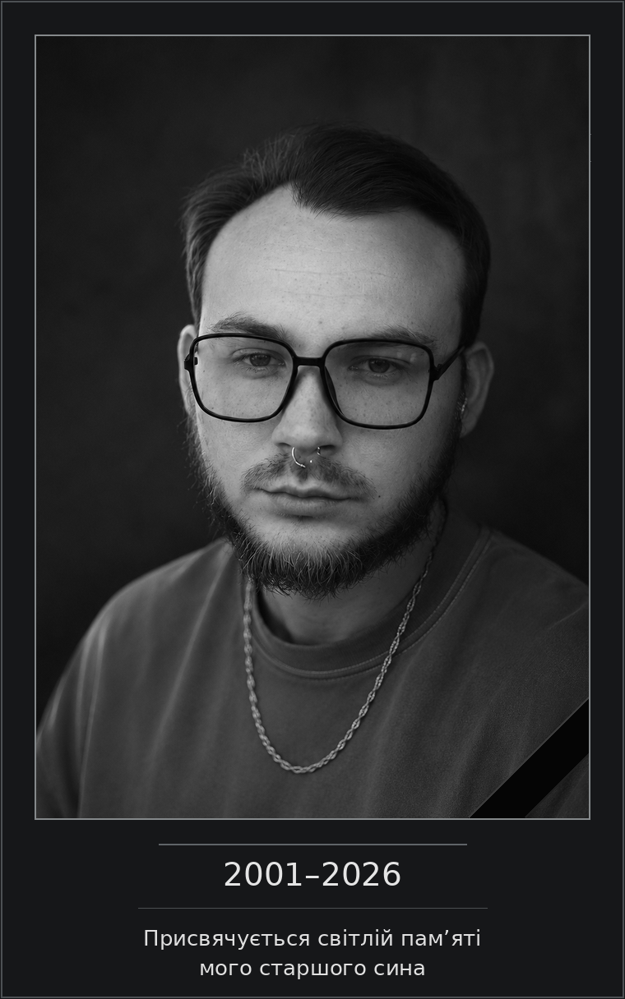
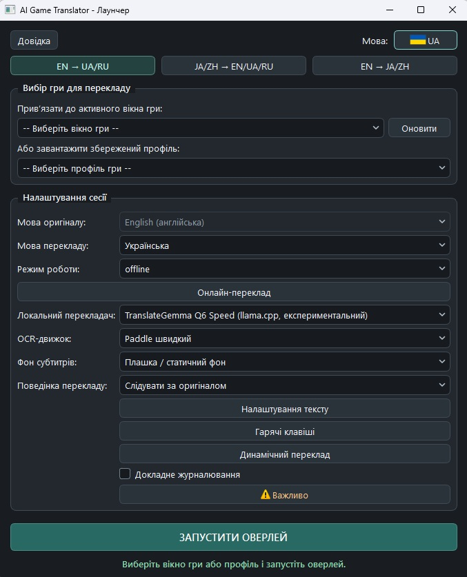

[English](README.md) · [Русский](README.ru.md) · **Українська** · [日本語](README.ja.md) · [简体中文](README.zh-Hans.md) · [繁體中文](README.zh-Hant.md)

<p align="center"></p>

# Games_translator

*Від ідеї до відкритого проєкту*

## Як усе починалося

Games_translator перекладає текст безпосередньо в комп’ютерних іграх.

Ідея виникла з простої і знайомої багатьом гравцям проблеми: цікавих ігор безліч, але далеко не кожну перекладено потрібною мовою. Іноді на локалізацію доводиться чекати роками, іноді вона існує лише у вигляді аматорського перекладу, а іноді її не буде взагалі.

Мені хотілося мати інструмент, який дозволив би просто запустити гру й розуміти, що відбувається, не відволікаючись постійно на інші перекладачі, знімки екрана чи ручне копіювання тексту.

Але початковий задум досить швидко став ширшим.

Я хотів, щоб програма не обмежувалася субтитрами або однією мовою. Щоб вона розпізнавала текст безпосередньо на екрані, перекладала його в реальному часі, підтримувала різні мовні напрями й давала користувачеві вибір між швидкістю, якістю та споживанням ресурсів.

Ще однією принциповою умовою був повноцінний автономний переклад. Не всі хочуть або можуть користуватися платними хмарними сервісами, а для деяких ігор постійна залежність від інтернету просто незручна.

Так почалася розробка Games_translator.

## Довгий шлях від ідеї до робочої програми

Спочатку проєкт здавався набагато простішим, ніж виявився на практиці.

Розпізнати текст на зображенні — одне завдання. Зробити так, щоб розпізнавання було достатньо швидким, не перевантажувало комп’ютер, давало раду різним ігровим шрифтам і не заважало самій грі, — зовсім інше.

А розпізнаний текст ще треба перекласти, правильно обробити результат і вчасно показати його на екрані, не дозволивши застарілій фразі з’явитися поверх наступної.

Під час розробки я випробував багато варіантів OCR, перекладачів, локальних мовних моделей і способів їх запуску. Одні рішення виглядали перспективними, але виявлялися надто повільними. Інші працювали швидко, але давали незадовільний результат. Третім потрібно було забагато оперативної або відеопам’яті.

Деякі рішення добре показували себе в окремих тестах, але в реальних іграх виявлялися проблеми, неочевидні на перший погляд.

Доводилося порівнювати, перевіряти, відмовлятися від одних варіантів і повертатися до інших. Іноді лише після тривалих випробувань ставало зрозуміло, що перспективний напрям не підходить для практичного використання.

Поступово я дійшов висновку, що переклад потрібно розділити на три підходи.

**Fast** — коли найважливіші швидкість і мінімальна затримка, навіть якщо якість перекладу не завжди задовільна.

**Quality** — коли потрібен більш осмислений переклад і користувач готовий пожертвувати частиною продуктивності.

**Online** — коли можна скористатися зовнішнім перекладачем, який залежно від сервісу може дати високу якість із невеликою затримкою.

Окремим великим завданням стало обладнання: використання відеокарти, керування пам’яттю, запуск локальних моделей, організація фонових процесів і зменшення навантаження під час гри.

Не меншої уваги потребували самі субтитри. Переклад має бути читабельним, не перекривати зайвого, правильно оновлюватися й дозволяти налаштувати відображення для конкретної гри.

Так з’явилися постійний переклад вибраної області екрана, динамічне виділення довільних ділянок, гнучкі налаштування оформлення, ігрові профілі, локальна пам’ять перекладів і підтримка кількох мовних напрямів.

Чимало дрібниць, майже непомітних у звичайному використанні, вимагали окремих досліджень, виправлень і повторних випробувань.

Розробка Games_translator забрала багато часу. Це був постійний пошук рішень і технічних компромісів, а не послідовне додавання функцій за готовим планом.

Звісно, я не вважаю програму ідеальною. Режими мають свої переваги й недоліки, деякі можливості потребують доволі потужного комп’ютера, а розпізнавання й переклад неминуче залежать від конкретної гри.

Але зрештою мені вдалося довести проєкт до стану повноцінного робочого застосунку, яким можна користуватися, а не лише демонструвати його можливості.

І для мене це справді було важливо.

## Чому Games_translator став безплатним

Спочатку Games_translator задумувався як комерційний продукт.

Крім інтересу до самого завдання, у мене була дуже особиста й важлива причина довести розробку до кінця.

Моя дружина бореться з онкологічним захворюванням IV стадії. Їй потрібне дороге лікування, і лише одна упаковка одного з необхідних препаратів коштує приблизно 1 000 доларів щомісяця.

Для нашої родини це величезні гроші.

Я сподівався створити корисну програму, продажі якої бодай частково допоможуть оплачувати лікування. Я не очікував великого комерційного успіху. Мені хотілося отримати додаткове джерело коштів, яке трохи полегшило б наше становище.

Саме тому я намагався не зупинятися на простому прототипі й поступово доводив Games_translator до стану завершеного продукту.

Проте розробка програмного забезпечення сьогодні змінюється надзвичайно швидко.

Поки я працював над Games_translator, інструменти створення застосунків ставали доступнішими, а схожі програми з’являлися дедалі частіше, зокрема цілком безплатні.

Поступово стало зрозуміло, що наступні місяці роботи над комерційним випуском можуть не виправдати себе. Навіть добре зроблена програма не обов’язково знайде достатньо покупців, особливо коли є безплатні альтернативи.

Це було непросте рішення, адже початкові сподівання на проєкт були пов’язані не лише з його технічною стороною.

Але мені не хотілося, щоб результат усієї роботи залишився лежати на моєму комп’ютері лише тому, що комерційні перспективи змінилися.

Тому я вирішив відмовитися від початкової моделі розповсюдження й відкрити Games_translator для всіх охочих.

**Програма розповсюджується безплатно, з відкритим вихідним кодом.**

Сподіваюся, вона стане в пригоді гравцям, які хочуть знайомитися з цікавими світами, історіями й персонажами незалежно від мови оригіналу.

Можливо, комусь вона допоможе пройти гру, до якої раніше не доходили руки через відсутність перекладу.

І тоді час, витрачений на створення Games_translator, точно не буде змарнований.

---

## Присвята

<p align="center"></p>

---

## Добровільна підтримка автора та допомога родині

Games_translator цілком безплатний. Завантаження, використання та вивчення вихідного коду не потребують оплати.

### Подяка за проєкт

Якщо програма стала вам у пригоді й ви захочете подякувати мені за роботу, можна зробити добровільний внесок.

### Допомога з лікуванням дружини

Також ви можете підтримати мою родину й допомогти придбати протипухлинні препарати для моєї дружини.

Я розумію, що в кожного свої обставини й можливості. Будь-яка підтримка є виключно добровільною й жодним чином не пов’язана з доступом до програми.

**Дякую всім, хто вирішив скористатися Games_translator, поділитися ним з іншими або підтримати мою родину.**

Способи підтримки наведено нижче.

Перед переказом перевірте адресу й мережу. Пожертва не є покупкою й не впливає на доступ.

**Bitcoin (BTC) · мережа Bitcoin**

```text
bc1quaew6d8gzvspnks5hn93fcnc28xlnvzhy3juc3
```


**Ethereum (ETH) · основна мережа Ethereum**

```text
0x76B010657fE338E6f7E8bB251631A42CB15a8924
```


**Tether USDT · лише TRON/TRC20**

```text
TN2sQMLi2Q4ziQsFzNe3futuo4SMQmhhgi
```


### Зв’язок з автором

З особистих питань пишіть на [gamestranslator.contact@gmail.com](mailto:gamestranslator.contact@gmail.com). Про помилки та пропозиції також можна повідомляти через [GitHub Issues](https://github.com/ZGeorg-tech/Games_translator/issues); ці повідомлення публічні.


# Games_translator: можливості й технічна документація

## 1. Що вміє Games_translator

Games_translator — безплатний застосунок для Windows 10/11, що розпізнає і перекладає ігровий текст безпосередньо під час гри.

Він захоплює зображення вибраної області ігрового вікна, розпізнає текст за допомогою OCR (оптичного розпізнавання символів), перекладає його й показує результат поверх гри. Залежно від режиму переклад виконується цілком на комп’ютері користувача або через зовнішній онлайн-сервіс.

**Основні можливості:**

- Переклад ігрових субтитрів у реальному часі.
- Переклад довільних областей ігрового вікна за запитом.
- Цілком локальна робота без обов’язкового доступу до інтернету.
- Три підходи до перекладу: Fast, Quality та Online.
- Англійська, російська, українська, японська, спрощена й традиційна китайська в передбачених напрямах.
- Кілька рушіїв OCR для різних видів ігрового тексту.
- Налаштування субтитрів: шрифт, розмір, колір, контур і фон.
- Автоматичне припасування тексту до доступної області.
- Можливість перекрити оригінальні субтитри перекладом.
- Індивідуальні ігрові профілі.
- Локальна Translation Memory для повторного використання перекладів.
- Налаштовувані гарячі клавіші.
- Підтримка локальних нейромережевих моделей з використанням GPU.
- Підключення зовнішніх API перекладу.
- Шість мов інтерфейсу.
- Портативна поставка з власним Python і необхідними бібліотеками.

Програма не встановлює переклад у файли гри й не змінює ігрові ресурси. Вона працює як окремий застосунок із власним оверлеєм.

<p align="center"><br><sub>Головне вікно лаунчера українською</sub></p>

---

## 2. Три мовні блоки

Games_translator поділено на три мовні блоки. Кожен призначено для певних напрямів перекладу й оснащено відповідним набором моделей.

### Block 1: англійська → російська / українська

| Мова оригіналу | Мова перекладу |
|---|---|
| English | Русский |
| English | Українська |

Блок призначено для ігор з англійським текстом. Він підтримує швидкий локальний переклад, додатковий Marian для напряму англійська → російська, Quality через TranslateGemma та онлайн-перекладачі.

### Block 2: японська / китайська → англійська / російська / українська

| Мова оригіналу | Доступні мови перекладу |
|---|---|
| 日本語, японська | English, Русский, Українська |
| 简体中文, спрощена китайська | English, Русский, Українська |
| 繁體中文, традиційна китайська | English, Русский, Українська |

Цей блок використовує OCR для китайського та японського тексту. Fast працює через Bergamot, а для російської й української використовується проміжний англійський маршрут. Quality використовує MiLMMT Q6 і перекладає безпосередньо або через передбачений проміжний маршрут залежно від напряму.

### Block 3: англійська → японська / китайська

| Мова оригіналу | Мова перекладу |
|---|---|
| English | 日本語 |
| English | 简体中文 |
| English | 繁體中文 |

У Fast використовуються FuguMT для японської й CSANMT для китайської. Традиційне письмо отримується через OpenCC. У Quality використовується MiLMMT Q6.

### Чому блоки розповсюджуються окремо?

Спочатку Games_translator був єдиною системою з усіма моделями й бібліотеками, приблизно 12,49 GiB.

Щоб користувачі не завантажували непотрібні мовні моделі, підготовлено три самостійні дистрибутиви для Windows. Кожен містить виконуваний файл, портативний Python, необхідні OCR- і MT-моделі, бібліотеки й runtime.

**Для роботи одного блоку не потрібно завантажувати два інші.**

<p align="center"></p>

---

## 3. Вибір підходу до перекладу

Одна з ключових можливостей — вибір між швидкістю, якістю та використанням зовнішніх сервісів.

| Характеристика | Fast | Quality | Online |
|---|---|---|---|
| Основний пріоритет | Швидкість | Якість | Можливості вибраного сервісу |
| Інтернет для перекладу | Не потрібний | Не потрібний | Потрібний |
| Навантаження на комп’ютер | Зазвичай невисоке або помірне | Значне | Переважно OCR та інтерфейс |
| Якість перекладу | Можливі помітні помилки | Зазвичай більш осмислений результат | Залежить від провайдера й моделі |
| Затримка | Зазвичай невелика | Вища, залежить від обладнання | Залежить від мережі та API |
| Зовнішня оплата | Не потрібна | Не потрібна | Можлива |

### Fast: швидкий переклад

Fast призначено передусім для гри, коли потрібен якнайшвидший переклад без надмірного навантаження. Використовуються порівняно легкі моделі машинного перекладу, орієнтовані на швидкість.

Fast може помилятися, хибно тлумачити контекст, імена й неоднозначні вислови. У деяких напрямах на результат впливає також проміжний переклад. Режим рекомендовано, коли безперервність гри важливіша за точність кожної репліки.

### Quality: якісний локальний переклад

Quality використовує важчі нейромережеві моделі для більш осмисленої обробки тексту. Він потребує більше ресурсів і зазвичай працює повільніше. На відміну від Online, переклад виконується локально, без надсилання тексту зовнішньому сервісу.

Quality особливо корисний у сюжетних іграх, діалогах і ситуаціях, де зміст важливіший за мінімальну затримку. **Локальний Quality потребує більше оперативної та відеопам’яті; працездатність і продуктивність залежать від обладнання.**

### Online: переклад через зовнішні сервіси

Online використовує сторонні хмарні системи машинного й нейромережевого перекладу. Залежно від сервісу можна отримати високу якість і малу затримку без запуску великої моделі на власному GPU.

- Потрібен інтернет.
- Деякі провайдери вимагають реєстрацію та API-ключ.
- Можливі платні тарифи, квоти й обмеження частоти запитів.
- Затримка залежить від мережі та навантаження сервісу.
- Розпізнаний ігровий текст надсилається вибраному провайдерові.
- Інтеграція не гарантує доступу вашого облікового запису до конкретної моделі.

Якщо API платний, оплата здійснюється безпосередньо провайдерові. Games_translator не включає платної підписки на ці сервіси.

---

## 4. Локальні перекладачі

| Модель / рушій | Застосування | Призначення |
|---|---|---|
| Bergamot | Block 1, Block 2 | Швидкий локальний переклад |
| Marian EN→RU | Block 1 | Додатковий локальний перекладач |
| TranslateGemma Q6 | Block 1 | Quality |
| MiLMMT Q6 | Block 2, Block 3 | Quality |
| CSANMT | Block 3 | Fast EN→ZH |
| FuguMT | Block 3 | Fast EN→JA |
| OpenCC | Block 3 | Перетворення китайського тексту на традиційне письмо |

**Bergamot** використовує локальний Node/WASM runtime і призначений для швидкого перекладу з переважним навантаженням на CPU. **Marian** є окремим варіантом перекладу з англійської на російську.

**TranslateGemma Q6** — модель Quality для Block 1. Low VRAM і Speed використовують одну модель із різними параметрами запуску. **MiLMMT Q6** спільна для напрямів Quality у Block 2 і Block 3.

Швидкі маршрути **CSANMT і FuguMT** в Block 3 орієнтовані на CPU, щоб не конкурувати з грою за додаткові ресурси GPU. Вибір моделі залежить від установленого блоку та профілю перекладу.

---

## 5. Розпізнавання тексту: OCR

Перед перекладом Games_translator знаходить і розпізнає текст на зображенні ігрового вікна. Для цього є кілька рушіїв OCR.

| OCR | Основне призначення | Особливості |
|---|---|---|
| Tesseract | Англійський текст | Легкий, добре підходить для чіткого контрастного тексту |
| Paddle Fast | Англійський текст | Швидке нейромережеве розпізнавання |
| Paddle Full | Складніший ігровий текст | Важчий варіант розпізнавання |
| Paddle CJK Fast | Китайський і японський текст | Спеціалізований OCR для Block 2 |

Доступність залежить від блоку й режиму роботи з текстом. **Tesseract** варто спробувати для звичайних англійських субтитрів із чітким шрифтом і достатнім контрастом. **Paddle Fast** — основний швидкий нейромережевий варіант для різноманітніших ігрових шрифтів. **Paddle Full** призначений для складніших умов, але може значно збільшити навантаження й затримку. **Paddle CJK Fast** розпізнає японський і китайський текст.

Жоден OCR не гарантує ідеального розпізнавання в усіх іграх. Результат залежить від шрифту, розміру символів, фону, ефектів, роздільності й правильно вибраної області захоплення.

---

## 6. Live і Dynamic

Два основні способи роботи з ігровим текстом можна використовувати окремо або разом.

### Live: постійний переклад

Live призначено передусім для субтитрів, звичайних діалогів і тексту, що з’являється приблизно в одній області. Розмістіть рамку над потрібною частиною вікна й увімкніть переклад. Програма стежить за змінами тексту, розпізнає нові фрази, перекладає й показує результат.

Рамку налаштовують у режимі Edit. Після переходу до Live оверлей працює у звичайному ігровому режимі. Програма перевіряє актуальність фрази, щоб запізнілий результат попереднього запиту не підмінив новішого перекладу.

### Dynamic: переклад довільної області

Dynamic перекладає текст поза основною рамкою Live. Натисніть гарячу клавішу й виділіть мишею частину ігрового вікна. Програма розпізнає та перекладе її вміст.

Це особливо зручно для:

- завдань і журналів;
- описів предметів;
- тексту інтерфейсу й меню;
- додаткових діалогів;
- окремих записок і повідомлень;
- тексту в незвичних місцях екрана.

**Dynamic можна використовувати самостійно**, без постійного Live. Для багатьох ігор найзручніше поєднання: **Live перекладає основні субтитри, Dynamic — усе інше за потреби.** Це рекомендовано, якщо текст з’являється в різних областях.

---

## 7. Оформлення субтитрів

Оверлей дозволяє налаштувати переклад під конкретну гру:

- розмір і колір шрифту;
- контур тексту;
- колір і прозорість фонової підкладки;
- область відображення;
- автоматичне припасування тексту;
- збереження оформлення в ігровому профілі.

### Adaptive Plate: адаптивна підкладка

В окремих іграх оригінальні субтитри розташовані на одноколірній плашці. Adaptive Plate добирає її колір із зображення гри й використовує його для перекриття оригінальних субтитрів під перекладом.

Режим працює в Live **лише для одноколірних підкладок без градієнтів**. На складному, неоднорідному або мінливому фоні колір може не збігатися з оточенням. Після вимкнення відновлюються звичайні користувацькі налаштування фону.

### Auto-Fit

У Live текст припасовується до області відображення. У Dynamic Auto-Fit добирає розмір вікна результату й шрифту. Це допомагає працювати з текстом різної довжини без постійних ручних змін.

---

## 8. Ігрові профілі та Translation Memory

### Профілі

Ігри можуть потребувати різних параметрів розпізнавання, перекладу й відображення. Окремі ігрові профілі зберігають мови, область розпізнавання, перекладач, OCR, оформлення, гарячі клавіші та інші параметри. Знайому гру не потрібно щоразу налаштовувати заново.

### Translation Memory: пам’ять перекладів

Translation Memory (TM) — локальна система повторного використання перекладів. Коли текст повторюється й відповідає збереженому маршруту перекладу, можна використати попередній результат без нового виклику моделі або зовнішнього API.

Це особливо корисно для повторюваних реплік, написів, меню та повідомлень інтерфейсу. TM враховує напрям і ідентичність перекладача, щоб не змішувати несумісні результати.

TM зберігається локально. Для деяких зовнішніх провайдерів діють додаткові обмеження збереження даних відповідно до політики інтеграції. **Хмарний обмін перекладами й публікацію користувацьких пакетів TM у цій версії не реалізовано.**

---

## 9. Підтримувані онлайн-провайдери

Спільна система Online Translation підтримує дванадцять сімейств провайдерів.

| Провайдер | Тип інтеграції |
|---|---|
| DeepL | Машинний переклад через API |
| Google Gemini | Нейромережевий переклад через API |
| Google Cloud Translation | Хмарний машинний переклад |
| Google Translate (неофіційний) | Зовнішній переклад без офіційного API-ключа |
| Microsoft Azure Translator | Хмарний машинний переклад |
| OpenAI | Нейромережеві моделі |
| OpenRouter | Доступ до моделей через API |
| DeepSeek | Нейромережеві моделі |
| Qwen-MT | Спеціалізований машинний переклад |
| Yandex Cloud Translate | Хмарний машинний переклад |
| Baidu Translate | Машинний переклад через API |
| GigaChat | Нейромережеві моделі |

### Ступінь перевірки

Для всіх інтеграцій автоматично перевірялися маршрути й обробка відповідей. **Не всі сервіси перевірено з реальними обліковими записами та API-ключами.**

- **DeepL:** реальний тест англійська → російська, 22 успішні запити з 22. Медіана часу мережевого worker перекладу в цьому тесті — близько 421 мс.
- **Gemini:** реальні переклади успішні, але в сеансі були відчутні коливання затримки й таймаути.
- **OpenRouter:** авторизація ключа успішна, але запит перекладу до вибраної моделі повертав HTTP 429.
- **Неофіційний Google Translate:** ручна перевірка дала HTTP 302. Працездатність за поточних умов не підтверджена.

Це результати конкретних випробувань, а не гарантія поточної продуктивності зовнішніх сервісів. Для інших інтеграцій успішні автоматичні тести не підтверджують доступність певного API для кожного користувача.

### Налаштування й безпека

Можна вибрати провайдера, модель і наявні параметри підключення. API-ключі зберігаються локально з використанням Windows DPAPI. Збережені облікові дані, підтверджена авторизація та можливість запиту до конкретної моделі — різні речі. Live і Dynamic мають незалежні таймаути зовнішнього перекладу. Програма не гарантує доступність, ціну чи якість послуг третіх сторін.

---

## 10. Обладнання й продуктивність

Games_translator розрахований насамперед на ігрові комп’ютери середнього та високого класу. Захоплення зображення, OCR, переклад і відображення працюють одночасно, тому продуктивність залежить від компонентів і самої гри.

| Компонент | Стан |
|---|---|
| Windows 10 / Windows 11 | Цільові операційні системи |
| Windows x64 | Архітектура готових комплектів |
| NVIDIA GPU | Основна перевірена платформа |
| CUDA | Перевірено на NVIDIA RTX 3060 |
| AMD GPU / Vulkan | Програмна підтримка передбачена, повної перевірки на AMD немає |
| Intel GPU | Не пройшов апаратну кваліфікацію |
| Fast на CPU | Реалізовано для відповідних моделей |
| Quality на CPU без придатного GPU | Не є гарантованим робочим режимом |

Fast зазвичай створює менше навантаження й краще підходить, коли ресурси потрібні самій грі. Quality використовує більші моделі й може значно витрачати VRAM, RAM та обчислювальні ресурси. Online виконує переклад на зовнішньому сервері, але захоплення зображення, OCR та інтерфейс залишаються локальними.

Основною перевіреною NVIDIA-конфігурацією була GeForce RTX 3060. Інша відеокарта не гарантує такої самої швидкості й сумісності. Універсальних мінімальних вимог до оперативної та відеопам’яті для всіх поєднань режимів не встановлено.

---

## 11. Завантаження Games_translator

Програма розповсюджується як три незалежні портативні комплекти для Windows x64.

| Комплект | Напрямки | Розмір ZIP | Частин |
| --- | --- | ---: | ---: |
| **Block 1** | EN → RU / UK | **5,82 GiB** | 4 |
| **Block 2** | JA / ZH → EN / RU / UK | **6,24 GiB** | 4 |
| **Block 3** | EN → JA / ZH | **8,85 GiB** | 5 |

[Block 1](docs/DOWNLOADS.md#block-1) · [Block 2](docs/DOWNLOADS.md#block-2) · [Block 3](docs/DOWNLOADS.md#block-3) · [GitHub Release R04b](https://github.com/ZGeorg-tech/Games_translator/releases/tag/r04b)

[Точні команди об’єднання та SHA256](docs/DOWNLOADS.md)

Усі частини одного блоку утворюють єдиний ZIP. **Інші блоки або повну збірку завантажувати не потрібно.**

### Чому комплект такий великий?

Окрім коду, комплект містить великі локальні мовні й OCR-моделі, runtime, портативний Python і потрібні бібліотеки. Наприклад, Quality використовує багатогігабайтні TranslateGemma Q6 або MiLMMT Q6, а Block 3 має додаткові компоненти для CSANMT.

Завдяки цьому локальний переклад не потребує постійного інтернету або зовнішньої підписки. Ціна автономності — більший розмір дистрибутива.

---

## 12. Установлення та перший запуск

Окремо встановлювати системний Python не потрібно.

1. **Завантаження.** Коли файли з’являться в Releases, виберіть блок і завантажте **всі частини лише цього блоку**. Наприклад, Block 1 має файли від `Games_translator-Block1-Windows-x64.zip.001` до `Games_translator-Block1-Windows-x64.zip.004`.
2. **Об’єднання.** Покладіть частини в одну папку. Використайте `UNPACK.md` із комплекту або точні команди й контрольні суми SHA256 за посиланням вище, щоб отримати звичайний ZIP і перевірити його.
3. **Розпакування.** Виберіть папку, доступну для запису. **Увесь шлях до програми має містити лише ASCII; пробіли допустимі.** Наприклад, `C:\GamesTranslator\Block1` або `D:\Games\Games Translator`. Уникайте кирилиці, китайських, японських та інших символів поза ASCII: через обмеження деяких нативних бібліотек Paddle OCR і CUDA можуть не завантажити ресурси.
4. **Запуск.** Відкрийте `Games_translator.exe`. Він використовує власне середовище Python і не потребує командного рядка для звичайного запуску. Каталог користувацьких даних створюється під час першого запуску.

### Налаштування

1. Запустіть гру.
2. Відкрийте Games_translator.
3. Виберіть ігрове вікно.
4. Виберіть мовний напрям.
5. Виберіть Offline або Online.
6. Для Offline виберіть доступний перекладач або профіль Fast/Quality.
7. Перевірте параметри OCR.
8. За потреби змініть гарячі клавіші й оформлення.
9. Запустіть оверлей.
10. Розмістіть рамку над текстом гри й увімкніть переклад.

Кнопка **«Довідка»** відкриває короткий посібник мовою інтерфейсу.

---

## 13. Гарячі клавіші й керування

Гарячі клавіші налаштовуються в програмі й зберігаються в ігровому профілі.

| Дія | Призначення |
|---|---|
| Налаштування / переклад | Перехід між редагуванням рамки й Live |
| Показати / приховати переклад | Керування видимістю |
| Dynamic | Виділення довільної області |
| Force Refresh | Повторне розпізнавання поточної області Live |

Призначення можна змінювати. Якщо комбінація не працює, перевірте, чи її не перехоплює гра або інша програма.

---

## 14. Діагностика й користувацькі дані

Докладне діагностичне логування за замовчуванням вимкнено. Для розбору помилки увімкніть **«Докладне логування»** в лаунчері. Зміна діє з наступного запуску оверлея.

Журнали можуть містити технічну інформацію, текст гри й результати перекладу. Перегляньте їх перед передаванням.

Профілі, TM, історія й налаштування — користувацькі дані, що зберігаються окремо від незмінних ресурсів. За замовчуванням використовується власний локальний каталог `data`, без потреби розміщувати робочі дані в системному Python чи прихованих каталогах розробки.

---

## 15. Відомі обмеження

Games_translator є робочою програмою, але не універсальною для всіх ігор, мовних ситуацій та комп’ютерів.

- **OCR:** художні шрифти, ефекти, рухомі фони й низький контраст погіршують розпізнавання.
- **Fast:** висока швидкість може призвести до неточностей, утрати контексту й неприродних фраз.
- **Quality:** може вимагати потужного обладнання і працювати помітно повільніше.
- **Online:** залежить від сторонніх сервісів, доступу до API, мережевих затримок, тарифів і квот. Не всі провайдери пройшли реальні тести.
- **Обладнання:** основна перевірена платформа — NVIDIA. AMD та Intel не пройшли повних апаратних тестів.
- **Шлях установлення:** уникайте кирилиці та інших символів поза ASCII.
- **Vulkan:** комплекти містять базовий runtime. Експериментальний постійний кеш Vulkan pipeline у публічну поставку не входить.
- **Античіт:** ігри й захисні системи можуть обмежувати захоплення, оверлеї й глобальні гарячі клавіші. Універсальна сумісність не гарантована; дотримуйтеся правил гри.
- **Оригінальні субтитри:** Adaptive Plate призначений для одноколірної підкладки; на складному фоні можливі видимі відмінності.

---

## 16. Вихідний код і ліцензії

Вихідний код Games_translator призначено для відкритої публікації. Сторонні бібліотеки, OCR, мовні моделі й runtime мають умови своїх правовласників. Ліцензії, авторство й походження описано окремо. Умови для моделей можуть відрізнятися від ліцензії коду програми. Розробникам, які вивчають або змінюють програму, слід враховувати ці умови під час подальшого розповсюдження.

---

## 17. Додаткова інформація

Якщо виникли труднощі з установленням або запуском, перевірте:

- правильність вибору мовного блоку;
- наявність усіх частин архіву;
- правильність розпакування й контрольних сум;
- відсутність кирилиці в шляху;
- доступність ігрового вікна;
- OCR і напрям перекладу;
- готовність локального перекладача;
- параметри підключення й обмеження Online.

Після публікації репозиторію GitHub для підтверджених помилок можна буде скористатися Issues. Games_translator надається безплатно й без гарантії сумісності з кожною грою або конфігурацією обладнання.

**Приємної гри незалежно від мови оригіналу.**


[Ліцензії, повідомлення та статус публікації](licenses/NOTICE.md) · [Issues (після публікації)](https://github.com/ZGeorg-tech/Games_translator/issues)
