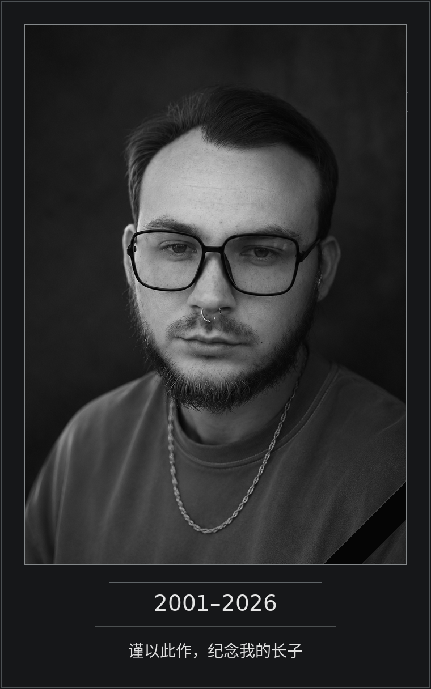
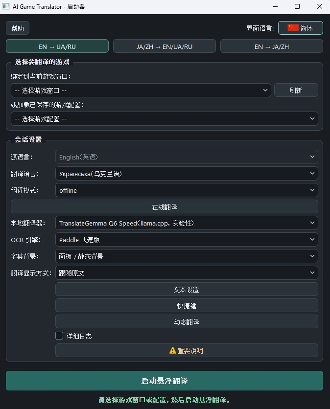

[English](README.md) · [Русский](README.ru.md) · [Українська](README.uk.md) · [日本語](README.ja.md) · **简体中文** · [繁體中文](README.zh-Hant.md)

<p align="center"></p>

# Games_translator

*从一个想法到公开项目*

## 最初的想法

Games_translator 是一款直接在电脑游戏中翻译文字的程序。

这个想法源于一个简单而又让许多玩家熟悉的问题：有趣的游戏很多，但并非每一款都译成了自己需要的语言。有时本地化要等上好几年，有时只有玩家制作的译本，有时则根本不会有翻译。

我想要一款工具，让我启动游戏后就能理解正在发生的事，不用一直切换到外部翻译器、截图或手动复制文字。

不过，最初的构想很快就扩展了。

我希望它不局限于字幕或一种语言，而是能直接识别屏幕上的文字、实时翻译、处理不同语言方向，同时让用户在速度、质量和资源占用之间作出选择。

另一个原则是支持完整的离线翻译。不是每个人都愿意或有条件使用付费云服务，对某些游戏来说，始终依赖网络也不方便。

Games_translator 的开发由此开始。

## 从想法到可用程序的漫长过程

这个项目最初看起来比实际简单得多。

从图片里识别文字是一回事；让识别足够快、不让电脑负担过重、适应不同的游戏字体，还不干扰游戏本身，则完全是另一回事。

识别出的文字还要翻译，结果要正确处理并及时显示，不能让上一句迟到的译文盖在下一句上。

在开发中，我试过许多 OCR 方案、翻译引擎、本地语言模型和运行方式。有些看起来前景不错，却太慢；有些很快，但效果不理想；还有一些占用过多内存或显存。

也有方案在单项测试中表现不错，到了真实游戏里却暴露出起初不易察觉的问题。

我不得不反复比较、验证，放弃一些方案，再回头试另一些。有时经过长时间试验，才确定一条看似有希望的路线不适合实际使用。

我逐渐意识到，需要把翻译分成三种方式。

**Fast** 适合最看重速度和低延迟的情况，即使翻译质量并不总能令人满意。

**Quality** 适合需要更贴合语义的译文，且用户愿意为此牺牲一部分性能的情况。

**Online** 使用外部翻译服务。根据服务的不同，有可能同时取得较高质量和较低延迟。

硬件又是一个独立的大课题：利用显卡、管理内存、启动本地模型、组织后台进程，以及降低游戏运行时的负载。

字幕本身也需要同样多的关注。译文要易读，不能遮住不该遮的内容，要正确更新，还要允许用户针对具体游戏调整显示方式。

最后实现了指定屏幕区域的持续翻译、任意区域的动态选取、灵活的外观设置、游戏配置文件、本地翻译记忆，以及多种语言方向。

许多平时几乎察觉不到的小细节，都需要单独研究、修正和反复测试。

开发 Games_translator 用了不少时间。这是不断寻找解决办法、在技术上作取舍的过程，而不是按事先写好的计划逐项添加功能。

我当然不认为它已经完美。不同模式各有利弊，一些功能需要性能较好的电脑，识别和翻译的表现也难免因游戏而异。

但我最终把它做成了真正可以使用的完整程序，而不只是一套用来展示功能的演示。

这对我确实很重要。

## 为什么 Games_translator 免费了

Games_translator 最初是作为商业产品构想的。

除了对这项技术的兴趣，我还有一个很私人、也很重要的理由，希望把开发做完。

我的妻子正在与 IV 期癌症抗争。她需要费用高昂的治疗，其中一种必需的药，每月仅一盒就要花费约 1,000 美元。

对我们家来说，这是一笔很大的开支。

我希望能做出一款有用的程序，让销售收入至少负担一部分治疗费用。我并不指望取得很大的商业成功，只是想多一个收入来源，让家里的处境稍微轻松一些。

因此我没有停在简单的原型阶段，而是努力一步步把 Games_translator 做成完整的产品。

不过，如今软件开发变化得非常快。

在我开发 Games_translator 的过程中，制作应用的工具越来越容易获得，类似的软件也越来越多，其中包括完全免费的选择。

我逐渐明白，再花几个月准备商业发行，未必值得。即使程序做得不错，也不一定能找到足够多的买家，尤其是在用户已有免费替代品时。

这个决定并不容易，因为我最初对项目的期待并不只是技术上的。

但我不愿仅仅因为商业前景发生变化，就把所有工作的成果留在自己的电脑上。

所以我决定放弃最初的发行方式，把 Games_translator 提供给所有愿意使用它的人。

**本程序免费提供，并公开源代码。**

我希望它能帮助那些不愿受原作语言限制、想了解有趣的世界、故事和人物的玩家。

也许有人可以借助它，通关一款以前因为没有翻译而始终没玩的游戏。

那样，花在 Games_translator 上的时间就一定没有白费。

---

## 献词

<p align="center"></p>

---

## 自愿支持作者并帮助家人

Games_translator 完全免费。下载、使用及研究源代码都不需要付费。

### 感谢项目作者

如果程序对你有帮助，你也愿意感谢我所做的工作，可以自愿捐助。

### 帮助支付妻子的治疗费用

你也可以支持我的家人，帮助我们购买妻子所需的抗肿瘤药物。

我理解每个人的处境和能力不同。任何支持都完全自愿，与能否使用本程序毫无关系。

**感谢每一位愿意使用 Games_translator、把它分享给别人或支持我家人的朋友。**

支持方式如下。

转账前请核对地址和网络。捐助不是购买，也不影响程序使用。

**Bitcoin (BTC) · Bitcoin 网络**

```text
bc1quaew6d8gzvspnks5hn93fcnc28xlnvzhy3juc3
```


**Ethereum (ETH) · Ethereum 主网**

```text
0x76B010657fE338E6f7E8bB251631A42CB15a8924
```


**Tether USDT · 仅限 TRON/TRC20**

```text
TN2sQMLi2Q4ziQsFzNe3futuo4SMQmhhgi
```


### 联系作者

如需私下联系，请发送邮件至 [gamestranslator.contact@gmail.com](mailto:gamestranslator.contact@gmail.com)。你也可以通过 [GitHub Issues](https://github.com/ZGeorg-tech/Games_translator/issues) 反馈问题和建议；Issues 内容是公开的。


# Games_translator：功能与技术文档

## 1. Games_translator 能做什么

Games_translator 是一款免费的 Windows 10/11 应用，可在游戏进行时识别并翻译游戏文字。

它捕获选定的游戏窗口区域，通过 OCR（光学字符识别）读取其中的文字，翻译后显示在游戏上方。根据所选模式，翻译可以完全在用户电脑上运行，也可以使用外部在线服务。

**主要功能：**

- 实时翻译游戏字幕。
- 按需翻译游戏窗口中的任意区域。
- 完全在本地运行，不强制联网。
- 三种翻译方式：Fast、Quality 和 Online。
- 在支持的语言方向中使用英语、俄语、乌克兰语、日语、简体中文和繁体中文。
- 针对不同游戏文字的多种 OCR 引擎。
- 可设置字幕字体、大小、颜色、描边和背景。
- 自动将文字调整到可用区域内。
- 可用译文覆盖原字幕。
- 保存各游戏的独立配置文件。
- 使用本地 Translation Memory 重用译文。
- 可自定义快捷键。
- 支持使用 GPU 的本地神经网络模型。
- 接入外部翻译 API。
- 六种界面语言。
- 自带 Python 和必要库的便携发行包。

程序不会把翻译安装到游戏文件中，也不会修改游戏资源。它作为独立应用运行，使用自己的叠加窗口。

<p align="center"><br><sub>简体中文启动器主窗口</sub></p>

---

## 2. 三个语言模块

Games_translator 分为三个语言模块。每个模块面向特定翻译方向，使用相应的模型。

### Block 1：英语 → 俄语 / 乌克兰语

| 源语言 | 目标语言 |
|---|---|
| English | Русский |
| English | Українська |

适用于含英语文字的游戏。支持快速本地翻译、可单独选择的 Marian 英语 → 俄语翻译、使用 TranslateGemma 的 Quality 以及在线翻译。

### Block 2：日语 / 中文 → 英语 / 俄语 / 乌克兰语

| 源语言 | 可选目标语言 |
|---|---|
| 日本語（日语） | English、Русский、Українська |
| 简体中文 | English、Русский、Українська |
| 繁體中文 | English、Русский、Українська |

使用面向中文和日文的 OCR。Fast 由 Bergamot 实现，译为俄语或乌克兰语时会经由英语中转。Quality 使用 MiLMMT Q6，根据方向直接翻译或采用预定的中转路径。

### Block 3：英语 → 日语 / 中文

| 源语言 | 目标语言 |
|---|---|
| English | 日本語 |
| English | 简体中文 |
| English | 繁體中文 |

Fast 使用 FuguMT 翻译日语、CSANMT 翻译中文，再由 OpenCC 转成繁体中文。Quality 使用 MiLMMT Q6。

### 为什么分开发行？

最初 Games_translator 将全部模型和库放在同一个系统里，完整套装约 12.49 GiB。

为避免用户下载用不到的语言模型，现已准备三个独立的 Windows 发行包。每个包都包含可执行文件、便携版 Python、所需的 OCR 和机器翻译模型、库及运行时。

**使用一个模块不需要下载另外两个。**

<p align="center"></p>

---

## 3. 选择翻译方式

可以在速度、质量和使用外部服务之间选择，这是本程序的一项主要特性。

| 项目 | Fast | Quality | Online |
|---|---|---|---|
| 优先事项 | 速度 | 质量 | 所选服务的能力 |
| 翻译时是否需要联网 | 不需要 | 不需要 | 需要 |
| 电脑负载 | 通常较低或中等 | 较高 | 主要是 OCR 和界面 |
| 翻译质量 | 可能有明显错误 | 通常更贴合语义 | 取决于提供商和模型 |
| 延迟 | 通常较小 | 较大，取决于硬件 | 取决于网络和 API |
| 是否需要向外部付费 | 不需要 | 不需要 | 可能需要 |

### Fast：快速翻译

面向需要迅速看到译文、又不想让电脑负担过重的游戏场景，使用相对轻量、以速度为目标的机器翻译模型。

它可能出错，也可能误解上下文、名字或有歧义的表达。在部分方向中，中转翻译也会影响最终质量。当游戏的连贯性比每一句的精确度更重要时，建议使用 Fast。

### Quality：注重质量的本地翻译

使用更重的神经网络模型，希望更好地理解文字，但消耗更多资源，通常也更慢。与 Online 不同，它在本地完成翻译，不把文字发给外部服务。

适合重剧情的游戏、对话，以及理解语义比低延迟更重要的情形。**本地 Quality 对内存和显存要求更高，能否运行及运行速度取决于硬件。**

### Online：使用外部服务翻译

可调用第三方云端机器翻译及神经网络翻译服务。视所选服务而定，无需用自己的 GPU 运行大模型，也可能得到高质量、低延迟的译文。

- 需要联网。
- 部分提供商要求注册并提供 API 密钥。
- 可能存在付费套餐、配额和请求频率限制。
- 延迟取决于网络和服务负载。
- 识别出的游戏文字会发送给选定的提供商。
- 已接入不代表你的账户一定能使用某个模型。

外部 API 如需付费，请直接向相应提供商支付。Games_translator 不含这些服务的付费订阅。

---

## 4. 本地翻译引擎

| 模型 / 引擎 | 使用模块 | 用途 |
|---|---|---|
| Bergamot | Block 1、Block 2 | 快速本地翻译 |
| Marian EN→RU | Block 1 | 可额外选择的本地翻译引擎 |
| TranslateGemma Q6 | Block 1 | Quality |
| MiLMMT Q6 | Block 2、Block 3 | Quality |
| CSANMT | Block 3 | Fast EN→ZH |
| FuguMT | Block 3 | Fast EN→JA |
| OpenCC | Block 3 | 转换为繁体中文 |

**Bergamot** 使用本地 Node/WASM 运行时，主要通过 CPU 快速翻译。**Marian** 是英语译俄语的独立选项。

**TranslateGemma Q6** 用于 Block 1 的 Quality。Low VRAM 与 Speed 使用同一个模型，启动参数不同。**MiLMMT Q6** 是 Block 2 和 Block 3 的共用模型，处理各自的 Quality 方向。

Block 3 的 Fast 路线中，**CSANMT 和 FuguMT** 面向 CPU 执行，以免额外与游戏争用显卡资源。模型的选择取决于安装的模块和所选翻译配置。

---

## 5. 文字识别：OCR

翻译前需要在游戏窗口图像中找到并识别文字，因此程序提供了多种 OCR 引擎。

| OCR | 主要用途 | 特点 |
|---|---|---|
| Tesseract | 英语文字 | 轻量，适合清晰、高对比度的文字 |
| Paddle Fast | 英语文字 | 快速的神经网络识别 |
| Paddle Full | 更复杂的游戏文字 | 负载更高的识别方案 |
| Paddle CJK Fast | 中文和日文 | Block 2 的专用 OCR |

可选引擎取决于语言模块和文字处理模式。字形清晰、背景对比度足够的普通英语字幕可先试 **Tesseract**；面对更多样的游戏字体，可以使用主要的快速神经网络方案 **Paddle Fast**。**Paddle Full** 适合更困难的识别条件，但可能明显增加负载和延迟。**Paddle CJK Fast** 用于日文和中文。

没有哪种 OCR 能保证在所有游戏中完美识别。结果取决于字体、字的大小、背景、图形效果、分辨率以及捕获区域是否选得恰当。

---

## 6. Live 与 Dynamic

两种主要的游戏文字处理方式可以单独使用，也可以结合使用。

### Live：持续翻译

主要用于字幕、常规对话，以及大致出现在同一区域的文字。把识别框放到游戏窗口的相应区域，然后打开翻译。程序监测文字变化，识别新句子，翻译并显示结果。

在 Edit 模式调整识别框，切换到 Live 后，叠加窗口进入正常游戏状态。程序检查识别出的句子是否仍然有效，避免旧请求的迟到结果替换较新的译文。

### Dynamic：按需翻译任意区域

可翻译 Live 主框以外的文字。按下快捷键后，用鼠标选定游戏窗口的目标区域，程序就会识别和翻译其中的内容。

尤其适用于：

- 游戏任务和日志。
- 物品说明。
- 界面和菜单文字。
- 额外的对话。
- 单独的便条或消息。
- 出现在屏幕非固定位置的文字。

**Dynamic 可以独立使用**，不需要持续运行 Live。许多游戏中最方便的组合是：**用 Live 翻译主要字幕，需要时用 Dynamic 翻译其他文字。** 当文字出现在多个不同区域时，建议采用这种组合。

---

## 7. 字幕设置

叠加窗口的外观可按游戏调整：

- 字号和文字颜色。
- 文字描边。
- 背景底板的颜色和透明度。
- 显示区域。
- 自动调整文字大小。
- 将外观保存到游戏配置文件。

### Adaptive Plate：自适应底板

某些游戏把原字幕放在纯色底板上。Adaptive Plate 可以从游戏图像中取样，用这种颜色盖住译文下方的原字幕。

它在 Live 中使用，**仅用于没有渐变的纯色底板**。面对复杂、不均匀或不断变化的背景时，颜色可能与周边图像不一致。关闭 Adaptive Plate 后会恢复普通的自定义背景设置。

### Auto-Fit

Live 将文字调整到显示区域内。Dynamic 的 Auto-Fit 会调整结果窗口和字号，以适应不同长度的文字，减少反复手动改设置的需要。

---

## 8. 游戏配置文件与 Translation Memory

### 游戏配置文件

不同游戏可能需要不同的识别、翻译和显示设置。独立的配置文件保存语言、识别区域、翻译引擎、OCR、外观、快捷键等参数。再次启动熟悉的游戏时，不必从头设置。

### Translation Memory：翻译记忆

Translation Memory（TM）是一套在本地重用已有译文的系统。如果文字再次出现，并与保存的翻译路径相符，程序可以直接重用结果，不再调用模型或外部 API。

对重复的台词、标牌、菜单和界面提示特别有用。TM 区分翻译方向和翻译引擎的标识，以免混用不相容的结果。

TM 保存在本地。对个别外部提供商，数据保存还需遵守相应接入策略的额外限制。**当前版本没有实现云端分享译文或发布用户 TM 包。**

---

## 9. 支持的在线提供商

共用的 Online Translation 系统支持十二类提供商。

| 提供商 | 接入方式 |
|---|---|
| DeepL | 通过 API 进行机器翻译 |
| Google Gemini | 通过 API 进行神经网络翻译 |
| Google Cloud Translation | 云端机器翻译 |
| Google Translate（非官方） | 无需官方 API 密钥的外部翻译 |
| Microsoft Azure Translator | 云端机器翻译 |
| OpenAI | 神经网络模型 |
| OpenRouter | 通过 API 使用模型 |
| DeepSeek | 神经网络模型 |
| Qwen-MT | 专用机器翻译 |
| Yandex Cloud Translate | 云端机器翻译 |
| Baidu Translate | 通过 API 进行机器翻译 |
| GigaChat | 神经网络模型 |

### 验证程度

所有接入都经过了翻译路径和响应处理的自动测试。**并非所有服务都用真实账户和 API 密钥进行过测试。**

- **DeepL：** 实际英语 → 俄语测试中，22 个请求全部成功。该测试的网络翻译 worker 用时中位数约为 421 毫秒。
- **Gemini：** 真实翻译成功，但测试会话中延迟明显波动，并出现超时。
- **OpenRouter：** 密钥授权检查成功，但向选定模型发送翻译请求返回 HTTP 429。
- **非官方 Google Translate：** 手动检查观察到 HTTP 302，当前条件下是否可用未获确认。

这些是特定测试的结果，不保证外部服务当前的表现。对其他接入而言，自动测试通过不表示每个用户都能调用特定 API。

### 设置与安全

可选择提供商、模型和相应的连接参数。API 密钥用 Windows DPAPI 保护，并保存在本地。已保存凭据、授权已确认、可向具体模型发出请求是三种不同状态。Live 与 Dynamic 可分别设置外部翻译超时。程序不保证第三方服务的可用性、价格或质量。

---

## 10. 硬件与性能

主要面向中高端游戏电脑。程序同时进行画面捕获、OCR、翻译和显示，实际表现取决于所选组件和游戏本身。

| 组件 | 状态 |
|---|---|
| Windows 10 / Windows 11 | 目标操作系统 |
| Windows x64 | 发行包的架构 |
| NVIDIA GPU | 主要验证平台 |
| CUDA | 已在 NVIDIA RTX 3060 上验证 |
| AMD GPU / Vulkan | 软件层面有支持，尚未在 AMD 上进行完整验证 |
| Intel GPU | 未通过硬件验证流程 |
| CPU Fast 翻译 | 对相应模型已实现 |
| 无合适 GPU 时在 CPU 上运行 Quality | 不保证可用 |

Fast 通常负载较低，适合需要给游戏留出资源的情形。Quality 使用更大的模型，可能明显占用显存、内存和算力。Online 将翻译交给外部服务器，但图像捕获、OCR 和界面仍在本地运行。

开发期间主要验证的 NVIDIA 配置是 GeForce RTX 3060。其他显卡不保证有相同速度或兼容性。尚未确定适用于所有模式组合的统一最低内存和显存要求。

---

## 11. 下载 Games_translator

程序以三个独立的 Windows x64 便携发行包提供。

| 安装包 | 翻译方向 | ZIP 大小 | 分卷数 |
| --- | --- | ---: | ---: |
| **Block 1** | EN → RU / UK | **5.82 GiB** | 4 |
| **Block 2** | JA / ZH → EN / RU / UK | **6.24 GiB** | 4 |
| **Block 3** | EN → JA / ZH | **8.85 GiB** | 5 |

**安装包将在发布后提供。目前没有 Releases 文件链接。**

[准确的合并命令与 SHA256](docs/DOWNLOADS.md)

同一模块的所有分卷组成一个 ZIP 文件。**不需要下载其他模块，也不需要完整套装。**

### 为什么下载体积这么大？

除程序代码外，发行包还包含大型本地语言模型、OCR 模型、运行时、便携版 Python 和必要的库。例如 Quality 使用体积达数 GiB 的 TranslateGemma Q6 或 MiLMMT Q6，而 Block 3 还包含运行 CSANMT 的组件。

本地翻译因此不强制联网，也不需要外部订阅。自主运行的代价是发行包较大。

---

## 12. 安装与首次运行

无需另外安装系统 Python。

1. **下载。** 发布后，在 Releases 选择需要的模块，并下载**该模块的全部分卷**。例如 Block 1 有四个分卷，从 `Games_translator-Block1-Windows-x64.zip.001` 到 `Games_translator-Block1-Windows-x64.zip.004`。
2. **合并。** 将分卷放在同一文件夹，使用随包提供的 `UNPACK.md` 或上方链接里的准确命令，把它们合成普通 ZIP 文件。可用发布文件附带的 SHA256 校验。
3. **解压。** 解压到可写的文件夹。**完整路径必须只使用 ASCII 字符，允许空格。** 例如 `C:\GamesTranslator\Block1` 或 `D:\Games\Games Translator`。不要在路径中使用西里尔字母、中文、日文或其他非 ASCII 字符；部分随包提供的原生库有此限制，Paddle OCR 或 CUDA 可能因此无法载入资源。
4. **运行。** 启动 `Games_translator.exe`。程序使用自带的 Python，正常运行无需命令行。首次运行时会创建用户数据目录。

### 配置

1. 启动游戏。
2. 打开 Games_translator。
3. 选择游戏窗口。
4. 选择翻译方向。
5. 选择 Offline 或 Online。
6. 如选 Offline，选择可用的翻译引擎或 Fast/Quality 配置。
7. 检查 OCR 设置。
8. 如有需要，调整快捷键和外观。
9. 启动叠加窗口。
10. 将识别框对准游戏文字，开启翻译。

内置的 **帮助** 按钮可用当前界面语言打开简明指南。

---

## 13. 快捷键与操作

可在程序设置中分配快捷键，键位保存在游戏配置文件中。

| 操作 | 用途 |
|---|---|
| 设置 / 翻译 | 在编辑识别框与 Live 之间切换 |
| 显示 / 隐藏译文 | 控制文字是否可见 |
| Dynamic | 选取任意区域 |
| Force Refresh | 重新识别当前 Live 区域 |

用户可修改键位。如果某组快捷键无效，请检查游戏或其他程序是否拦截了它。

---

## 14. 诊断与用户数据

默认关闭详细诊断日志。需要排查错误时，可在启动器打开 **详细日志**。更改将在下次启动叠加窗口时生效。

日志可能包含技术信息、游戏文字和译文，分享前请先查看。

配置文件、翻译记忆、历史记录和设置属于用户数据，与不变的资源分开保存。Games_translator 默认使用自己的本地 `data` 目录，不要求将工作数据放进系统 Python 或隐藏的开发目录。

---

## 15. 已知限制

Games_translator 是可用的程序，但不能在每款游戏、每种语言情形和每台电脑上都取得同样的效果。

- **OCR：** 艺术字体、特效、动态背景和低对比度都可能降低识别效果。
- **Fast：** 高速度可能伴随不准确、上下文缺失和不自然的表述。
- **Quality：** 可能需要强劲的硬件，并明显慢于其他模式。
- **Online：** 取决于第三方服务、API 访问权限、网络延迟、价格和配额。并非每个提供商都经过实测。
- **硬件：** 主要验证平台是 NVIDIA。AMD 和 Intel 尚未通过完整硬件测试确认。
- **安装路径：** 不要使用西里尔字母或其他非 ASCII 字符。
- **Vulkan：** 发行包包含基础运行时，不包含使用持久化 Vulkan pipeline 缓存的实验版本。
- **反作弊：** 游戏或保护系统可能限制捕获、叠加窗口和全局快捷键。不保证普遍兼容；请遵守相应游戏的规则。
- **原字幕：** Adaptive Plate 面向纯色底板。背景复杂时可能出现可见差异。

---

## 16. 源代码与许可证

Games_translator 的源代码将公开。使用的第三方库、OCR 系统、语言模型和运行时各自遵循权利方的条款。许可证、署名和来源另见项目文档。模型条款可能与应用源代码的许可证不同。希望研究或修改程序的开发者，在再分发时应考虑这些条件。

---

## 17. 其他信息

如果安装或启动遇到问题，请检查：

- 是否选择了正确的语言模块。
- 是否下载了全部分卷。
- 是否正确解压以及校验值是否一致。
- 路径中是否含有西里尔字母。
- 游戏窗口是否可用。
- OCR 和翻译方向是否正确。
- 本地翻译引擎是否已就绪。
- Online 的连接设置及服务限制。

GitHub 仓库公开后，确认的错误可在 Issues 报告。Games_translator 免费提供，不保证与每款游戏和硬件配置兼容。

**不论原作使用哪种语言，祝你玩得愉快。**


[许可证、声明与发布状态](licenses/NOTICE.md) · [Issues（发布后）](https://github.com/ZGeorg-tech/Games_translator/issues)
