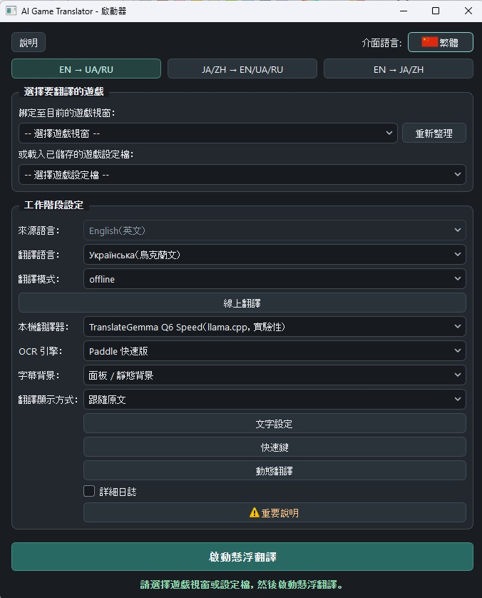

[English](README.md) · [Русский](README.ru.md) · [Українська](README.uk.md) · [日本語](README.ja.md) · [简体中文](README.zh-Hans.md) · **繁體中文**

<p align="center"></p>

# Games_translator

Games_translator 是一款免費、開放原始碼的 Windows 遊戲畫面翻譯工具。它透過 OCR 辨識遊戲視窗指定區域的文字，並將譯文即時疊加在遊戲畫面上。翻譯可以在電腦上離線執行，也可視需要使用線上翻譯服務。

| 下載 Windows 版 (R04b) | 翻譯方向 |
| --- | --- |
| [Block 1](docs/DOWNLOADS.md#block-1) | 英文 → 俄文 / 烏克蘭文 |
| [Block 2](docs/DOWNLOADS.md#block-2) | 日文 / 簡體中文 / 繁體中文 → 英文 / 俄文 / 烏克蘭文 |
| [Block 3](docs/DOWNLOADS.md#block-3) | 英文 → 日文 / 簡體中文 / 繁體中文 |

想把英文遊戲翻譯成繁體中文、簡體中文或日文，請選 **Block 3**。只需下載符合所需翻譯方向的區塊。

*從一個想法到公開專案*

## 最初的想法

Games_translator 是一款直接在電腦遊戲中翻譯文字的程式。

這個想法源於一個簡單而又讓許多玩家熟悉的問題：有趣的遊戲很多，但並非每一款都譯成了自己需要的語言。有時本地化要等上好幾年，有時只有玩家製作的譯本，有時則根本不會有翻譯。

我想要一款工具，讓我啟動遊戲後就能理解正在發生的事，不用一直切換到外部翻譯器、截圖或手動複製文字。

不過，最初的構想很快就擴充套件了。

我希望它不侷限於字幕或一種語言，而是能直接識別螢幕上的文字、即時翻譯、處理不同語言方向，同時讓使用者在速度、品質和資源佔用之間作出選擇。

另一個原則是支援完整的離線翻譯。不是每個人都願意或有條件使用付費雲服務，對某些遊戲來說，始終依賴網路也不方便。

Games_translator 的開發由此開始。

## 從想法到可用程式的漫長過程

這個專案最初看起來比實際簡單得多。

從圖片裡識別文字是一回事；讓識別足夠快、不讓電腦負擔過重、適應不同的遊戲字型，還不干擾遊戲本身，則完全是另一回事。

識別出的文字還要翻譯，結果要正確處理並及時顯示，不能讓上一句遲到的譯文蓋在下一句上。

在開發中，我試過許多 OCR 方案、翻譯引擎、本地語言模型和執行方式。有些看起來前景不錯，卻太慢；有些很快，但效果不理想；還有一些佔用過多記憶體或視訊記憶體。

也有方案在單項測試中表現不錯，到了真實遊戲裡卻暴露出起初不易察覺的問題。

我不得不反覆比較、驗證，放棄一些方案，再回頭試另一些。有時經過長時間試驗，才確定一條看似有希望的路線不適合實際使用。

我逐漸意識到，需要把翻譯分成三種方式。

**Fast** 適合最看重速度和低延遲的情況，即使翻譯品質並不總能令人滿意。

**Quality** 適合需要更貼合語義的譯文，且使用者願意為此犧牲一部分效能的情況。

**Online** 使用外部翻譯服務。根據服務的不同，有可能同時取得較高品質和較低延遲。

硬體又是一個獨立的大課題：利用顯示卡、管理記憶體、啟動本地模型、組織背景處理程序，以及降低遊戲執行時的負載。

字幕本身也需要同樣多的關注。譯文要易讀，不能遮住不該遮的內容，要正確更新，還要允許使用者針對具體遊戲調整顯示方式。

最後實現了指定螢幕區域的持續翻譯、任意區域的動態選取、靈活的外觀設定、遊戲設定檔、本地翻譯記憶，以及多種語言方向。

許多平時幾乎察覺不到的小細節，都需要單獨研究、修正和反覆測試。

開發 Games_translator 用了不少時間。這是不斷尋找解決辦法、在技術上作取捨的過程，而不是按事先寫好的計劃逐項新增功能。

我當然不認為它已經完美。不同模式各有利弊，一些功能需要效能較好的電腦，識別和翻譯的表現也難免因遊戲而異。

但我最終把它做成了真正可以使用的完整程式，而不只是一套用來展示功能的演示。

這對我確實很重要。

## 為什麼 Games_translator 改為免費提供

Games_translator 最初是作為商業產品構想的。

除了對這項技術的興趣，我還有一個很私人、也很重要的理由，希望把開發做完。

我的妻子正在與 IV 期癌症抗爭。她需要費用高昂的治療，其中一種必需的藥，每月僅一盒就要花費約 1,000 美元。

對我們家來說，這是一筆很大的開支。

我希望能做出一款有用的程式，讓銷售收入至少負擔一部分治療費用。我並不指望取得很大的商業成功，只是想多一個收入來源，讓家裡的處境稍微輕鬆一些。

因此我沒有停在簡單的原型階段，而是努力一步步把 Games_translator 做成完整的產品。

不過，如今軟體開發變化得非常快。

在我開發 Games_translator 的過程中，製作應用的工具越來越容易獲得，類似的軟體也越來越多，其中包括完全免費的選擇。

我逐漸明白，再花幾個月準備商業發行，未必值得。即使程式做得不錯，也不一定能找到足夠多的買家，尤其是在使用者已有免費替代品時。

這個決定並不容易，因為我最初對專案的期待並不只是技術上的。

但我不願僅僅因為商業前景發生變化，就把所有工作的成果留在自己的電腦上。

所以我決定放棄最初的發行方式，把 Games_translator 提供給所有願意使用它的人。

**本程式免費提供，並公開原始碼。**

我希望它能幫助那些不願受原作語言限制、想了解有趣的世界、故事和人物的玩家。

也許有人可以藉助它，通關一款以前因為沒有翻譯而始終沒玩的遊戲。

那樣，花在 Games_translator 上的時間就一定沒有白費。

---

## 獻詞

<p align="center"></p>

---

## 自願支援作者並幫助家人

Games_translator 完全免費。下載、使用及研究原始碼都不需要付費。

### 感謝專案作者

如果程式對你有幫助，你也願意感謝我所做的工作，可以自願捐助。

### 協助支付妻子的治療費用

你也可以支援我的家人，幫助我們購買妻子所需的抗癌藥物。

我理解每個人的處境和能力不同。任何支援都完全自願，與能否使用本程式毫無關係。

**感謝每一位願意使用 Games_translator、把它分享給別人或支援我家人的朋友。**

支援方式如下。

轉帳前請核對地址和網路。捐助不是購買，也不影響程式使用。

**Bitcoin (BTC) · Bitcoin 網路**

```text
bc1quaew6d8gzvspnks5hn93fcnc28xlnvzhy3juc3
```


**Ethereum (ETH) · Ethereum 主網**

```text
0x76B010657fE338E6f7E8bB251631A42CB15a8924
```


**Tether USDT · 僅限 TRON/TRC20**

```text
TN2sQMLi2Q4ziQsFzNe3futuo4SMQmhhgi
```


### 聯絡作者

如需私下聯絡，請寄信至 [gamestranslator.contact@gmail.com](mailto:gamestranslator.contact@gmail.com)。也可以透過 [GitHub Issues](https://github.com/ZGeorg-tech/Games_translator/issues) 反映問題和建議；Issues 內容是公開的。


# Games_translator：功能與技術文件

## 1. Games_translator 能做什麼

Games_translator 是一款免費的 Windows 10/11 應用，可在遊戲進行時識別並翻譯遊戲文字。

它捕獲選定的遊戲視窗區域，通過 OCR（光學字元識別）讀取其中的文字，翻譯後顯示在遊戲上方。根據所選模式，翻譯可以完全在使用者電腦上執行，也可以使用外部線上服務。

**主要功能：**

- 即時翻譯遊戲字幕。
- 按需翻譯遊戲視窗中的任意區域。
- 完全在本地執行，不強制聯網。
- 三種翻譯方式：Fast、Quality 和 Online。
- 在支援的語言方向中使用英語、俄語、烏克蘭語、日語、簡體中文和繁體中文。
- 針對不同遊戲文字的多種 OCR 引擎。
- 可設定字幕字型、大小、顏色、描邊和背景。
- 自動將文字調整到可用區域內。
- 可用譯文覆蓋原字幕。
- 儲存各遊戲的獨立設定檔。
- 使用本地 Translation Memory 重用譯文。
- 可自定義快捷鍵。
- 支援使用 GPU 的本地神經網路模型。
- 接入外部翻譯 API。
- 六種介面語言。
- 自帶 Python 和必要庫的便攜發行套件。

程式不會把翻譯安裝到遊戲檔案中，也不會修改遊戲資源。它作為獨立應用執行，使用自己的疊加視窗。

<p align="center"><br><sub>繁體中文啟動器主視窗</sub></p>

---

## 2. 三個語言模組

Games_translator 分為三個語言模組。每個模組面向特定翻譯方向，使用相應的模型。

### Block 1：英語 → 俄語 / 烏克蘭語

| 來源語言 | 目標語言 |
|---|---|
| English | Русский |
| English | Українська |

適用於含英語文字的遊戲。支援快速本地翻譯、可單獨選擇的 Marian 英語 → 俄語翻譯、使用 TranslateGemma 的 Quality 以及線上翻譯。

### Block 2：日語 / 中文 → 英語 / 俄語 / 烏克蘭語

| 來源語言 | 可選目標語言 |
|---|---|
| 日本語（日語） | English、Русский、Українська |
| 簡體中文 | English、Русский、Українська |
| 繁體中文 | English、Русский、Українська |

使用面向中文和日文的 OCR。Fast 由 Bergamot 實現，譯為俄語或烏克蘭語時會經由英語中轉。Quality 使用 MiLMMT Q6，根據方向直接翻譯或採用預定的中轉路徑。

### Block 3：英語 → 日語 / 中文

| 來源語言 | 目標語言 |
|---|---|
| English | 日本語 |
| English | 簡體中文 |
| English | 繁體中文 |

Fast 使用 FuguMT 翻譯日語、CSANMT 翻譯中文，再由 OpenCC 轉成繁體中文。Quality 使用 MiLMMT Q6。

### 為什麼分開發行？

最初 Games_translator 將全部模型和庫放在同一個系統裡，完整套裝約 12.49 GiB。

為避免使用者下載用不到的語言模型，現已準備三個獨立的 Windows 發行套件。每個套件都包含執行檔、可攜版 Python、所需的 OCR 和機器翻譯模型、函式庫及執行環境。

**使用一個模組不需要下載另外兩個。**

<p align="center"></p>

---

## 3. 選擇翻譯方式

可以在速度、品質和使用外部服務之間選擇，這是本程式的一項主要特性。

| 專案 | Fast | Quality | Online |
|---|---|---|---|
| 優先事項 | 速度 | 品質 | 所選服務的能力 |
| 翻譯時是否需要聯網 | 不需要 | 不需要 | 需要 |
| 電腦負載 | 通常較低或中等 | 較高 | 主要是 OCR 和介面 |
| 翻譯品質 | 可能有明顯錯誤 | 通常更貼合語義 | 取決於服務供應商和模型 |
| 延遲 | 通常較小 | 較大，取決於硬體 | 取決於網路和 API |
| 是否需要向外部付費 | 不需要 | 不需要 | 可能需要 |

### Fast：快速翻譯

面向需要迅速看到譯文、又不想讓電腦負擔過重的遊戲場景，使用相對輕量、以速度為目標的機器翻譯模型。

它可能出錯，也可能誤解上下文、名字或有歧義的表達。在部分方向中，中轉翻譯也會影響最終品質。當遊戲的連貫性比每一句的精確度更重要時，建議使用 Fast。

### Quality：注重品質的本地翻譯

使用更重的神經網路模型，希望更好地理解文字，但消耗更多資源，通常也更慢。與 Online 不同，它在本地完成翻譯，不把文字發給外部服務。

適合重劇情的遊戲、對話，以及理解語義比低延遲更重要的情形。**本地 Quality 對記憶體和視訊記憶體要求更高，能否執行及執行速度取決於硬體。**

### Online：使用外部服務翻譯

可呼叫第三方雲端機器翻譯及神經網路翻譯服務。視所選服務而定，無需用自己的 GPU 執行大模型，也可能得到高品質、低延遲的譯文。

- 需要聯網。
- 部分服務供應商要求註冊並提供 API 金鑰。
- 可能存在付費套餐、配額和請求頻率限制。
- 延遲取決於網路和服務負載。
- 識別出的遊戲文字會發送給選定的服務供應商。
- 已接入不代表你的帳號一定能使用某個模型。

外部 API 如需付費，請直接向相應服務供應商支付。Games_translator 不含這些服務的付費訂閱。

---

## 4. 本地翻譯引擎

| 模型 / 引擎 | 使用模組 | 用途 |
|---|---|---|
| Bergamot | Block 1、Block 2 | 快速本地翻譯 |
| Marian EN→RU | Block 1 | 可額外選擇的本地翻譯引擎 |
| TranslateGemma Q6 | Block 1 | Quality |
| MiLMMT Q6 | Block 2、Block 3 | Quality |
| CSANMT | Block 3 | Fast EN→ZH |
| FuguMT | Block 3 | Fast EN→JA |
| OpenCC | Block 3 | 轉換為繁體中文 |

**Bergamot** 使用本地 Node/WASM 執行環境，主要通過 CPU 快速翻譯。**Marian** 是英語譯俄語的獨立選項。

**TranslateGemma Q6** 用於 Block 1 的 Quality。Low VRAM 與 Speed 使用同一個模型，啟動參數不同。**MiLMMT Q6** 是 Block 2 和 Block 3 的共用模型，處理各自的 Quality 方向。

Block 3 的 Fast 路線中，**CSANMT 和 FuguMT** 面向 CPU 執行，以免額外與遊戲爭用顯示卡資源。模型的選擇取決於安裝的模組和所選翻譯配置。

---

## 5. 文字識別：OCR

翻譯前需要在遊戲視窗影像中找到並識別文字，因此程式提供了多種 OCR 引擎。

| OCR | 主要用途 | 特點 |
|---|---|---|
| Tesseract | 英語文字 | 輕量，適合清晰、高對比度的文字 |
| Paddle Fast | 英語文字 | 快速的神經網路識別 |
| Paddle Full | 更復雜的遊戲文字 | 負載更高的識別方案 |
| Paddle CJK Fast | 中文和日文 | Block 2 的專用 OCR |

可選引擎取決於語言模組和文書處理模式。字形清晰、背景對比度足夠的普通英語字幕可先試 **Tesseract**；面對更多樣的遊戲字型，可以使用主要的快速神經網路方案 **Paddle Fast**。**Paddle Full** 適合更困難的識別條件，但可能明顯增加負載和延遲。**Paddle CJK Fast** 用於日文和中文。

沒有哪種 OCR 能保證在所有遊戲中完美識別。結果取決於字型、字的大小、背景、圖形效果、解析度以及捕獲區域是否選得恰當。

---

## 6. Live 與 Dynamic

兩種主要的遊戲文書處理方式可以單獨使用，也可以結合使用。

### Live：持續翻譯

主要用於字幕、常規對話，以及大致出現在同一區域的文字。把識別框放到遊戲視窗的相應區域，然後開啟翻譯。程式監測文字變化，識別新句子，翻譯並顯示結果。

在 Edit 模式調整識別框，切換到 Live 後，疊加視窗進入正常遊戲狀態。程式檢查識別出的句子是否仍然有效，避免舊請求的遲到結果替換較新的譯文。

### Dynamic：按需翻譯任意區域

可翻譯 Live 主框以外的文字。按下快捷鍵後，用滑鼠選定遊戲視窗的目標區域，程式就會識別和翻譯其中的內容。

尤其適用於：

- 遊戲任務和日誌。
- 物品說明。
- 介面和選單文字。
- 額外的對話。
- 單獨的便條或訊息。
- 出現在螢幕非固定位置的文字。

**Dynamic 可以獨立使用**，不需要持續執行 Live。許多遊戲中最方便的組合是：**用 Live 翻譯主要字幕，需要時用 Dynamic 翻譯其他文字。** 當文字出現在多個不同區域時，建議採用這種組合。

---

## 7. 字幕設定

疊加視窗的外觀可按遊戲調整：

- 字號和文字顏色。
- 文字描邊。
- 背景底板的顏色和透明度。
- 顯示區域。
- 自動調整文字大小。
- 將外觀儲存到遊戲設定檔。

### Adaptive Plate：自適應底板

某些遊戲把原字幕放在純色底板上。Adaptive Plate 可以從遊戲影像中取樣，用這種顏色蓋住譯文下方的原字幕。

它在 Live 中使用，**僅用於沒有漸變的純色底板**。面對複雜、不均勻或不斷變化的背景時，顏色可能與周邊影像不一致。關閉 Adaptive Plate 後會恢復普通的自定義背景設定。

### Auto-Fit

Live 將文字調整到顯示區域內。Dynamic 的 Auto-Fit 會調整結果視窗和字號，以適應不同長度的文字，減少反覆手動改設定的需要。

---

## 8. 遊戲設定檔與 Translation Memory

### 遊戲設定檔

不同遊戲可能需要不同的識別、翻譯和顯示設定。獨立的設定檔儲存語言、識別區域、翻譯引擎、OCR、外觀、快捷鍵等參數。再次啟動熟悉的遊戲時，不必從頭設定。

### Translation Memory：翻譯記憶

Translation Memory（TM）是一套在本地重用已有譯文的系統。如果文字再次出現，並與儲存的翻譯路由相符，程式可以直接重用結果，不再呼叫模型或外部 API。

對重複的臺詞、標牌、選單和介面提示特別有用。TM 區分翻譯方向和翻譯引擎的標識，以免混用不相容的結果。

TM 儲存在本地。對個別外部服務供應商，資料儲存還需遵守相應接入策略的額外限制。**當前版本沒有實現雲端分享譯文或發布使用者 TM 包。**

---

## 9. 支援的線上服務供應商

共用的 Online Translation 系統支援十二類服務供應商。

| 服務供應商 | 接入方式 |
|---|---|
| DeepL | 通過 API 進行機器翻譯 |
| Google Gemini | 通過 API 進行神經網路翻譯 |
| Google Cloud Translation | 雲端機器翻譯 |
| Google Translate（非官方） | 無需官方 API 金鑰的外部翻譯 |
| Microsoft Azure Translator | 雲端機器翻譯 |
| OpenAI | 神經網路模型 |
| OpenRouter | 通過 API 使用模型 |
| DeepSeek | 神經網路模型 |
| Qwen-MT | 專用機器翻譯 |
| Yandex Cloud Translate | 雲端機器翻譯 |
| Baidu Translate | 通過 API 進行機器翻譯 |
| GigaChat | 神經網路模型 |

### 驗證程度

所有接入都經過了翻譯路由和回應處理的自動測試。**並非所有服務都用真實帳號和 API 金鑰進行過測試。**

- **DeepL：** 實際英語 → 俄語測試中，22 個請求全部成功。該測試的網路翻譯 worker 用時中位數約為 421 毫秒。
- **Gemini：** 真實翻譯成功，但測試會話中延遲明顯波動，並出現超時。
- **OpenRouter：** 金鑰授權檢查成功，但向選定模型傳送翻譯請求返回 HTTP 429。
- **非官方 Google Translate：** 手動檢查觀察到 HTTP 302，當前條件下是否可用未獲確認。

這些是特定測試的結果，不保證外部服務當前的表現。對其他接入而言，自動測試通過不表示每個使用者都能呼叫特定 API。

### 設定與安全

可選擇服務供應商、模型和相應的連線參數。API 金鑰用 Windows DPAPI 保護，並儲存在本地。已儲存憑據、授權已確認、可向具體模型發出請求是三種不同狀態。Live 與 Dynamic 可分別設定外部翻譯超時。程式不保證第三方服務的可用性、價格或品質。

---

## 10. 硬體與效能

主要面向中高階遊戲電腦。程式同時進行畫面捕獲、OCR、翻譯和顯示，實際表現取決於所選元件和遊戲本身。

| 元件 | 狀態 |
|---|---|
| Windows 10 / Windows 11 | 目標作業系統 |
| Windows x64 | 發行套件的架構 |
| NVIDIA GPU | 主要驗證平臺 |
| CUDA | 已在 NVIDIA RTX 3060 上驗證 |
| AMD GPU / Vulkan | 軟體層面有支援，尚未在 AMD 上進行完整驗證 |
| Intel GPU | 未通過硬體驗證流程 |
| CPU Fast 翻譯 | 對相應模型已實現 |
| 無合適 GPU 時在 CPU 上執行 Quality | 不保證可用 |

Fast 通常負載較低，適合需要給遊戲留出資源的情形。Quality 使用更大的模型，可能明顯佔用視訊記憶體、記憶體和算力。Online 將翻譯交給外部伺服器，但畫面擷取、OCR 和介面仍在本地執行。

開發期間主要驗證的 NVIDIA 配置是 GeForce RTX 3060。其他顯示卡不保證有相同速度或相容性。尚未確定適用於所有模式組合的統一最低記憶體和視訊記憶體要求。

---

## 11. 下載 Games_translator

程式以三個獨立的 Windows x64 便攜發行套件提供。

| 安裝套件 | 翻譯方向 | ZIP 大小 | 分卷數 |
| --- | --- | ---: | ---: |
| **Block 1** | EN → RU / UK | **5.82 GiB** | 4 |
| **Block 2** | JA / ZH → EN / RU / UK | **6.24 GiB** | 4 |
| **Block 3** | EN → JA / ZH | **8.85 GiB** | 5 |

[Block 1](docs/DOWNLOADS.md#block-1) · [Block 2](docs/DOWNLOADS.md#block-2) · [Block 3](docs/DOWNLOADS.md#block-3) · [GitHub Release R04b](https://github.com/ZGeorg-tech/Games_translator/releases/tag/r04b)

[正確的合併指令與 SHA256](docs/DOWNLOADS.md)

同一模組的所有分卷組成一個 ZIP 檔案。**不需要下載其他模組，也不需要完整套裝。**

### 為什麼下載體積這麼大？

除程式碼外，發行套件還包含大型本地語言模型、OCR 模型、執行環境、可攜版 Python 和必要的函式庫。例如 Quality 使用體積達數 GiB 的 TranslateGemma Q6 或 MiLMMT Q6，而 Block 3 還包含執行 CSANMT 的元件。

本地翻譯因此不強制聯網，也不需要外部訂閱。自主執行的代價是發行套件較大。

---

## 12. 安裝與首次執行

無需另外安裝系統 Python。

1. **下載。** 發布後，在 Releases 選擇需要的模組，並下載**該模組的全部分卷**。例如 Block 1 有四個分卷，從 `Games_translator-Block1-Windows-x64.zip.001` 到 `Games_translator-Block1-Windows-x64.zip.004`。
2. **合併。** 將分卷放在同一資料夾，使用隨套件提供的 `UNPACK.md` 或上方連結裡的正確指令，把它們合成普通 ZIP 檔案。可用發布檔案附帶的 SHA256 驗證。
3. **解壓。** 解壓到可寫的資料夾。**完整路徑必須只使用 ASCII 字元，允許空格。** 例如 `C:\GamesTranslator\Block1` 或 `D:\Games\Games Translator`。不要在路徑中使用西里爾字母、中文、日文或其他非 ASCII 字元；部分隨套件提供的原生庫有此限制，Paddle OCR 或 CUDA 可能因此無法載入資源。
4. **執行。** 啟動 `Games_translator.exe`。程式使用自帶的 Python，正常執行無需命令提示字元。首次執行時會建立使用者資料目錄。

### 配置

1. 啟動遊戲。
2. 開啟 Games_translator。
3. 選擇遊戲視窗。
4. 選擇翻譯方向。
5. 選擇 Offline 或 Online。
6. 如選 Offline，選擇可用的翻譯引擎或 Fast/Quality 配置。
7. 檢查 OCR 設定。
8. 如有需要，調整快捷鍵和外觀。
9. 啟動疊加視窗。
10. 將識別框對準遊戲文字，開啟翻譯。

內建的 **幫助** 按鈕可用當前介面語言開啟簡明指南。

---

## 13. 快捷鍵與操作

可在程式設定中分配快捷鍵，鍵位儲存在遊戲設定檔中。

| 操作 | 用途 |
|---|---|
| 設定 / 翻譯 | 在編輯識別框與 Live 之間切換 |
| 顯示 / 隱藏譯文 | 控制文字是否可見 |
| Dynamic | 選取任意區域 |
| Force Refresh | 重新識別當前 Live 區域 |

使用者可修改鍵位。如果某組快捷鍵無效，請檢查遊戲或其他程式是否攔截了它。

---

## 14. 診斷與使用者資料

預設關閉詳細診斷日誌。需要排查錯誤時，可在啟動器開啟 **詳細日誌**。更改將在下次啟動疊加視窗時生效。

日誌可能包含技術資訊、遊戲文字和譯文，分享前請先檢視。

設定檔、翻譯記憶、歷史記錄和設定屬於使用者資料，與不變的資源分開儲存。Games_translator 預設使用自己的本地 `data` 目錄，不要求將工作資料放進系統 Python 或隱藏的開發目錄。

---

## 15. 已知限制

Games_translator 是可用的程式，但不能在每款遊戲、每種語言情形和每臺電腦上都取得同樣的效果。

- **OCR：** 藝術字體、特效、動態背景和低對比度都可能降低識別效果。
- **Fast：** 高速度可能伴隨不準確、上下文缺失和不自然的表述。
- **Quality：** 可能需要強勁的硬體，並明顯慢於其他模式。
- **Online：** 取決於第三方服務、API 存取權限、網路延遲、價格和配額。並非每個服務供應商都經過實測。
- **硬體：** 主要驗證平臺是 NVIDIA。AMD 和 Intel 尚未通過完整硬體測試確認。
- **安裝路徑：** 不要使用西里爾字母或其他非 ASCII 字元。
- **Vulkan：** 發行套件包含基礎執行環境，不包含使用持久化 Vulkan pipeline 快取的實驗版本。
- **反作弊：** 遊戲或保護系統可能限制捕獲、疊加視窗和全域性快捷鍵。不保證普遍相容；請遵守相應遊戲的規則。
- **原字幕：** Adaptive Plate 面向純色底板。背景複雜時可能出現可見差異。

---

## 16. 原始碼與授權條款

Games_translator 的原始碼將公開。使用的第三方函式庫、OCR 系統、語言模型和執行環境各自遵循權利方的條款。授權條款、署名和來源另見專案文件。模型條款可能與應用原始碼的授權條款不同。希望研究或修改程式的開發者，在重新散布時應考慮這些條件。

---

## 17. 其他資訊

如果安裝或啟動遇到問題，請檢查：

- 是否選擇了正確的語言模組。
- 是否下載了全部分卷。
- 是否正確解壓以及驗證值是否一致。
- 路徑中是否含有西里爾字母。
- 遊戲視窗是否可用。
- OCR 和翻譯方向是否正確。
- 本地翻譯引擎是否已就緒。
- Online 的連線設定及服務限制。

GitHub 儲存庫公開後，確認的錯誤可在 Issues 報告。Games_translator 免費提供，不保證與每款遊戲和硬體配置相容。

**不論原作使用哪種語言，祝你玩得愉快。**


[授權條款、聲明與發布狀態](licenses/NOTICE.md) · [Issues（發布後）](https://github.com/ZGeorg-tech/Games_translator/issues)
